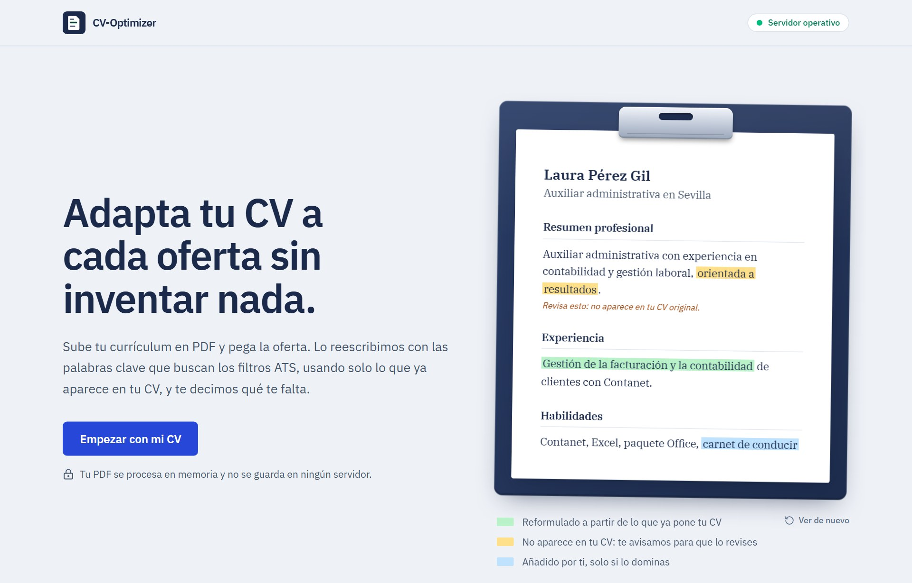
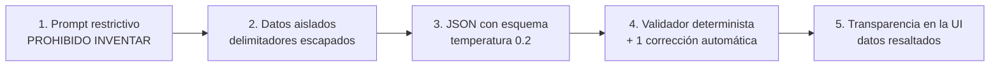
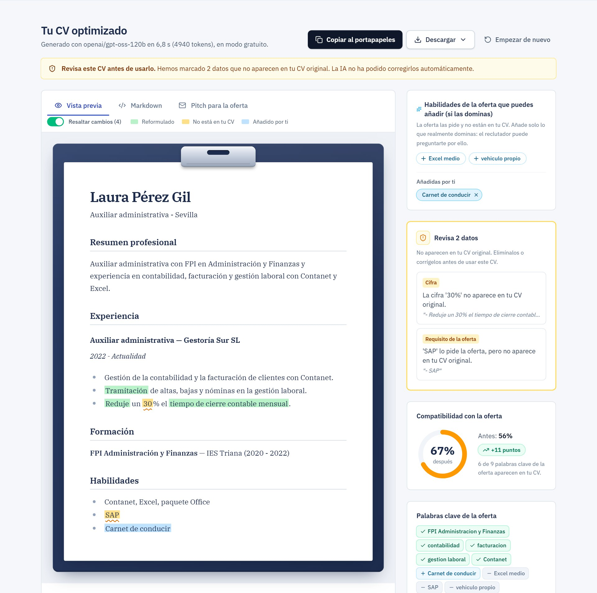
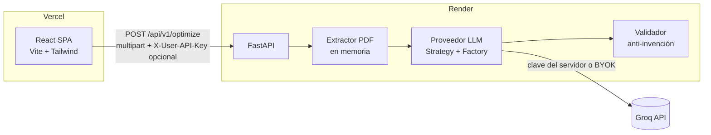

<div align="center">

# CV-Optimizer

**Adapta tu CV a cada oferta de trabajo para superar los filtros ATS. Sin inventar nada.**


[](LICENSE)



</div>

---

## Índice

- [¿Qué hace?](#qué-hace)
- [La regla de oro: cero datos inventados](#la-regla-de-oro-cero-datos-inventados)
- [Arquitectura](#arquitectura)
- [Privacidad por diseño](#privacidad-por-diseño)
- [Stack tecnológico](#stack-tecnológico)
- [Estructura del repositorio](#estructura-del-repositorio)
- [Puesta en marcha en local](#puesta-en-marcha-en-local)
- [Tests y calidad](#tests-y-calidad)
- [API](#api)
- [Despliegue (Render + Vercel)](#despliegue-render--vercel)
- [Roadmap](#roadmap)
- [Cómo se ha construido](#cómo-se-ha-construido)
- [Licencia](#licencia)

## ¿Qué hace?

1. **Subes tu CV en PDF** y **pegas la oferta de empleo**.
2. Un LLM reescribe el CV con la terminología de la oferta, en un formato limpio de una columna que los ATS leen bien.
3. Un **validador determinista** comprueba que todo lo que aparece en el CV optimizado estaba en tu CV original.
4. Recibes:
   - El **CV optimizado**, con las **reformulaciones resaltadas en verde** respecto a tu original (solo en pantalla).
   - Descarga en **Word (.docx)**, **PDF** con texto real o Markdown, sin ningún resaltado.
   - La **compatibilidad antes y después** con la oferta.
   - Las palabras clave cubiertas y las que faltan.
   - Los **gaps**: lo que pide la oferta y tú no acreditas. Se te informa, pero la IA nunca lo añade al CV.
   - Hasta 6 **sugerencias ATS**: requisitos de la oferta que no están en tu CV. Si los dominas, los añades tú con un clic.

| Funcionalidad | Detalle |
|---|---|
| Modo gratuito | Usa la clave de Groq del servidor, con un límite por IP. |
| **BYOK** (*Bring Your Own Key*) | Introduces tu propia API key de Groq: sin límites, y la clave nunca se guarda. |
| Exportación para ATS | **DOCX** (recomendado: lo leen todos los ATS, con estilos de título y viñetas nativas de Word) y **PDF** con texto seleccionable, nunca una imagen. Se generan en el navegador, así que el CV no vuelve a subirse. |
| Oferta en un solo campo | Pega el **texto** (Ctrl+A en la web de la oferta: se limpia solo), el **enlace** (se lee con Jina Reader; si el portal lo bloquea, te dice cómo seguir) o **capturas de pantalla** (OCR en tu navegador: la imagen no se sube a ningún servidor). |
| Nivel de ajuste | **Sutil** (mantiene tus frases y solo incorpora palabras clave) o **Profundo** (reescribe el enfoque con verbos de acción y logros, sin inventar resultados). |
| Pitch para la oferta | Tercera pestaña con un mensaje breve (1 párrafo y 3 viñetas) para la carta de presentación de InfoJobs o un mensaje por LinkedIn, validado igual que el CV. |
| Memoria local (opcional) | "Recordar mi CV en este navegador": el PDF se guarda en tu navegador (IndexedDB), nunca en el servidor, y se puede olvidar con un clic. |
| Sugerencias ATS | Chips con los requisitos verificables que te faltan (nunca rasgos personales). Al pulsarlos se añaden a la sección de habilidades, resaltados en azul como "Añadido por ti", y la puntuación se recalcula. Se pueden quitar. La decisión es tuya, no de la IA. En los requisitos que faltan, **"Sí tengo experiencia en esto"** te deja explicarlo en una frase y elegir dónde va: en Habilidades o en el puesto donde lo usaste. |
| Filtro de cookies | Los banners de cookies y consentimiento copiados con la oferta se eliminan antes de enviarla, en el navegador y en el servidor. |
| Arranque en frío | El frontend "despierta" el backend de Render al cargar la página y avisa si tarda. |
| Accesibilidad | Navegación por teclado, `aria-live` en los estados de carga y modo oscuro automático. |

## La regla de oro: cero datos inventados

Inventar experiencia en un CV puede costarle el puesto a un candidato. Por eso es la **regla de negocio más estricta** del proyecto y se aplica en **cinco capas**, porque ninguna basta por sí sola:



El **validador** ([`output_validator.py`](backend/app/services/output_validator.py)) no usa un LLM, así que es barato, reproducible y testeable. Contrasta el CV generado con el original:

| Comprobación | Ejemplo de lo que detecta |
|---|---|
| `UNGROUNDED_DATE` | "2017 – Actualidad" cuando el original dice 2021 |
| `UNGROUNDED_METRIC` | "reduje la latencia un **45%**" cuando el original dice 30% |
| `UNGROUNDED_ENTITY` | Empresas, títulos, puestos ("Tech Lead"), emails o URLs que no estaban |
| `UNGROUNDED_SKILL` | Habilidades añadidas ("Rust") o niveles inflados ("Inglés nativo" en lugar de B2) |
| `UNGROUNDED_CLAIM` | Informativo: afirmaciones del resumen sin apoyo en el CV ("orientada a la mejora continua"). El resumen puede reescribirse con el vocabulario de la oferta, así que se avisa, pero no se fuerza la corrección |
| `KEYWORD_DROPPED` | Informativo: una palabra clave de la oferta que ya estaba en tu CV y la optimización quitó; antes se intenta recuperar automáticamente |
| `GAP_LEAKED` | Un requisito de la oferta ("Kubernetes") colado en el CV sin estar en el original |

Si encuentra algo:

1. Pide **una corrección** al LLM con la lista exacta de lo que no está respaldado.
2. Si persiste, el resultado se marca como `needs_review`: la interfaz **resalta cada dato** en la vista previa y, al pulsar un aviso, te lleva a él.
3. La puntuación de compatibilidad **no puede subir a base de inventar**: una keyword añadida sin estar en el original no cuenta.

Acepta en cambio las reformulaciones veraces: sinónimos (`JS ↔ JavaScript`, `Postgres ↔ PostgreSQL`), plurales y reordenaciones. Los tests cubren tanto los casos que debe detectar como los falsos positivos que debe evitar.

<div align="center">

<br/><sub>Ejemplo con datos de demostración (CV ficticio y respuesta simulada del LLM): el validador marca en ámbar el "30%" y "SAP", que no estaban en el CV original; en verde, lo reformulado; en azul, el "Carnet de conducir" que el usuario añadió desde las sugerencias.</sub>
</div>

## Arquitectura



Decisiones destacadas (todas justificadas en el [SDD](SDD.md)):

- **Stateless y sin base de datos**: nada que filtrar, escala horizontalmente y despliegue trivial.
- **Proveedor de LLM intercambiable** (patrón Strategy + Factory). Groq usa la API compatible con OpenAI sobre `httpx`, con reintentos con backoff, `Retry-After` y un **modelo de reserva** si el principal se satura o se retira.
- **BYOK a través del backend**: la clave viaja solo en una cabecera HTTPS, nunca en la URL ni en el cuerpo. Así todas las peticiones pasan por el mismo prompt y el mismo validador.
- **Errores tipados** con un código estable (`PDF_NO_TEXT`, `BYOK_KEY_INVALID`, `RATE_LIMITED`…) que el frontend traduce en mensajes accionables.

## Privacidad por diseño

- El PDF se procesa **en RAM** (`io.BytesIO`) y **nunca toca el disco**. Starlette escribe en disco los archivos subidos de más de 1 MB, así que se sube ese límite y **un test lo verifica** con un PDF de 4,5 MB.
- Un test de arquitectura impide usar `tempfile` o escribir archivos en el código de la app.
- Los logs solo registran **metadatos** (tamaños, latencias, tokens). Nunca el contenido del CV ni las claves, y un filtro enmascara cualquier clave que se cuele.
- En el navegador, la clave BYOK vive en memoria. Solo se guarda en `sessionStorage` si el usuario lo pide, y **nunca en `localStorage`**.

## Stack tecnológico

| Capa | Tecnologías |
|---|---|
| Frontend | React 19, TypeScript, Vite, Tailwind CSS 4, react-markdown (+ sanitizado), lucide-react |
| Backend | Python 3.12, FastAPI, Pydantic v2, httpx, pypdf |
| LLM | Groq (GPT-OSS 120B principal, GPT-OSS 20B de reserva; configurables) |
| Calidad | pytest + respx, Vitest + Testing Library, ruff, GitHub Actions |
| Infraestructura | Vercel (frontend), Render (backend) con un Blueprint `render.yaml` |

## Estructura del repositorio

```
cv-optimizer/
├── backend/                  # API FastAPI
│   ├── app/
│   │   ├── api/              # Rutas, dependencias y manejo de errores
│   │   ├── core/             # Configuración, middlewares, rate limit, logging
│   │   ├── prompts/          # Prompts versionados (.md)
│   │   ├── schemas/          # Modelos Pydantic
│   │   └── services/         # Extractor PDF, LLM, validador, puntuación, orquestador
│   └── tests/
├── frontend/                 # SPA React
│   └── src/
│       ├── components/       # FileUploader, JobDescription, ApiKeySettings, result/…
│       ├── hooks/            # useOptimize, useByokKey, useServerStatus…
│       └── services/api.ts   # Cliente HTTP tipado
├── docs/images/
├── .github/workflows/ci.yml
├── render.yaml               # Blueprint de Render
└── SDD.md                    # Documento de diseño del sistema
```

## Puesta en marcha en local

**Requisitos:** Python 3.12+ y Node.js 20.19+. Opcional: una [API key de Groq](https://console.groq.com/keys). Sin ella funciona el modo BYOK.

### Backend

```bash
cd backend
python -m venv .venv
.venv\Scripts\activate        # Windows  ·  source .venv/bin/activate en macOS/Linux
pip install -r requirements-dev.txt
cp .env.example .env          # añade GROQ_API_KEY (opcional)
uvicorn app.main:app --reload --port 8000
```

En desarrollo, la documentación interactiva está en http://localhost:8000/docs.

### Frontend

```bash
cd frontend
npm install
cp .env.example .env.local    # VITE_API_BASE_URL=http://localhost:8000
npm run dev
```

Abre http://localhost:5173.

### Variables de entorno principales

| Variable | Dónde | Descripción |
|---|---|---|
| `GROQ_API_KEY` | backend | Clave del modo gratuito. Si está vacía, solo funciona BYOK. |
| `ALLOWED_ORIGINS` | backend | Orígenes permitidos por CORS, separados por comas. |
| `ALLOWED_ORIGIN_REGEX` | backend | Opcional, para las previews de Vercel. |
| `GROQ_MODEL_PRIMARY` / `GROQ_MODEL_FALLBACK` | backend | Modelos de Groq. |
| `RATE_LIMIT_PER_MINUTE` / `RATE_LIMIT_PER_DAY` | backend | Límite por IP del modo gratuito. |
| `VITE_API_BASE_URL` | frontend | URL pública del backend. |
| `VITE_REPO_URL` | frontend | Opcional: muestra el enlace a GitHub en la cabecera. |

La lista completa está en [`backend/.env.example`](backend/.env.example) y [`config.py`](backend/app/core/config.py).

## Tests y calidad

```bash
cd backend && pytest -q && ruff check app tests     # 137 tests
cd frontend && npm test && npm run build             # 67 tests + typecheck + build
```

Qué cubren:

- **Validador anti-invención:** fechas, cifras, entidades, habilidades, gaps filtrados, sinónimos aceptados, falsos positivos y CVs traducidos.
- **Detector de reformulaciones:** reformular se marca, reordenar no; ignora palabras vacías, tildes, plurales y sinónimos, y no pisa los avisos en ámbar.
- **Flujo completo con el LLM simulado** (`respx`): corrección automática, `needs_review`, JSON inválido y su reparación, reserva ante un 429, *timeouts* y clave BYOK inválida.
- **Privacidad:** el PDF no se escribe en disco y no hay claves ni contenido en los logs.
- **Seguridad:** inyección de prompts mediante delimitadores, CORS (incluidas las respuestas de error), límite de tamaño y rate limit.
- **Frontend:** subida y validación del PDF, Markdown renderizado sin ejecutar HTML, resaltado en verde y ámbar con su interruptor, portapapeles (con método alternativo), arranque en frío y que la clave BYOK nunca acabe en `localStorage`.
- **Exportación:** el DOCX es un ZIP válido con estilos `Heading1/2` y viñetas nativas; el PDF no contiene imágenes, y se ha comprobado con `pypdf` que su texto (tildes y ñ incluidas) se extrae completo.

La CI ([`ci.yml`](.github/workflows/ci.yml)) ejecuta lint, tests y build en cada push y en cada pull request.

## API

| Método | Ruta | Descripción |
|---|---|---|
| `GET` | `/health` | Estado del servicio y disponibilidad del modo gratuito. |
| `POST` | `/api/v1/optimize` | `multipart/form-data` con `cv_file` (PDF), `job_offer` y `output_language` (`auto` \| `es` \| `en`). Cabeceras opcionales: `X-User-API-Key` y `X-LLM-Provider`. |
| `POST` | `/api/v1/keys/validate` | Comprueba una clave BYOK (en `X-User-API-Key`) sin consumir tokens. |

<details>
<summary>Ejemplo de respuesta de <code>/api/v1/optimize</code></summary>

```json
{
  "optimized_markdown": "# Ana García López\n\n## Resumen profesional\n...",
  "match": {
    "score_before": 62,
    "score_after": 75,
    "matched_keywords": ["Python", "FastAPI", "PostgreSQL"],
    "missing_keywords": ["Kubernetes"]
  },
  "gaps": ["Kubernetes: la oferta lo pide y no aparece en tu CV."],
  "changes_summary": ["Resumen orientado a backend con Python."],
  "warnings": [],
  "quality": "ok",
  "meta": { "mode": "server", "model": "openai/gpt-oss-120b", "latency_ms": 4870, "...": "..." }
}
```

Los errores siempre tienen la forma `{"error": {"code", "message", "request_id"}}`.
</details>

## Despliegue (Render + Vercel)

El backend va primero, porque el frontend necesita su URL.

### 1. Backend en Render

1. Sube el repositorio a GitHub.
2. En [Render](https://dashboard.render.com), elige **New → Blueprint** y selecciona el repositorio. Render leerá [`render.yaml`](render.yaml).
3. Cuando te los pida, rellena:
   - `GROQ_API_KEY`: tu clave de Groq.
   - `ALLOWED_ORIGINS`: la URL de Vercel (paso 2), p. ej. `https://cv-optimizer.vercel.app`. Puedes poner una provisional y cambiarla después.
   - `ALLOWED_ORIGIN_REGEX` (opcional): `https://cv-optimizer-.*\.vercel\.app` para las previews.
4. Cuando termine el despliegue, comprueba `https://<tu-servicio>.onrender.com/health`.

> En el plan gratuito, Render duerme el servicio tras unos 15 minutos sin tráfico y el primer arranque tarda 30-60 s. El frontend lo despierta al cargar la página y avisa al usuario.

### 2. Frontend en Vercel

1. En [Vercel](https://vercel.com/new), importa el repositorio.
2. En **Root Directory**, pon `frontend`. Vercel detecta Vite y lee [`vercel.json`](frontend/vercel.json).
3. Añade la variable `VITE_API_BASE_URL=https://<tu-servicio>.onrender.com` y despliega.
4. Vuelve a Render y ajusta `ALLOWED_ORIGINS` con la URL definitiva de Vercel.

> `vercel.json` incluye cabeceras de seguridad y una **Content-Security-Policy** que permite conectar con `https://*.onrender.com`. Si usas un dominio propio para el backend, añádelo a `connect-src`.

### Checklist tras desplegar

- [ ] `/health` responde `200` y el indicador de la cabecera dice "Servidor operativo".
- [ ] Una optimización de prueba funciona en modo gratuito.
- [ ] La validación de una clave BYOK funciona.
- [ ] No hay errores de CORS ni de CSP en la consola del navegador.

## Roadmap

- [x] Exportar a PDF/DOCX compatibles con ATS.
- [x] Resaltar en pantalla lo reformulado respecto al CV original.
- [ ] Vista diff lado a lado entre el CV original y el optimizado.
- [ ] OCR para PDFs escaneados.
- [ ] Más proveedores BYOK (OpenAI, Anthropic) sobre la misma interfaz `LLMProvider`.
- [ ] Streaming del progreso real (SSE).

## Cómo se ha construido

El proyecto se ha desarrollado con **desarrollo guiado por especificación**: primero el [SDD](SDD.md) y después la implementación, por fases. Como agente de implementación se ha usado **Claude Code** (Anthropic). El autor ha definido el producto y las reglas de negocio, ha aprobado cada plan antes de implementarlo y ha probado la aplicación en producción. El agente ha escrito el código y los tests y se ha encargado de la verificación técnica.

En [`docs/PROCESO.md`](docs/PROCESO.md) se detallan el reparto de responsabilidades, el ciclo de trabajo, los fallos que solo aparecieron en producción y cómo se resolvieron, las prácticas de verificación y las lecciones aprendidas.

## Licencia

Distribuido bajo la licencia [MIT](LICENSE). © 2026 Francisco Muñoz Dorado.

---

<div align="center">
<sub>El diseño completo, los requisitos y las decisiones de arquitectura (ADRs) están en <a href="SDD.md">SDD.md</a>.</sub>
</div>
