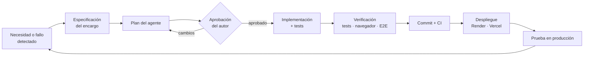

# Proceso de desarrollo: especificación primero, implementación con un agente de IA

> CV-Optimizer se ha desarrollado con **desarrollo guiado por especificación** (*Spec-Driven Development*) y con **Claude Code** (Anthropic) como agente de implementación. Las decisiones de producto, las reglas de negocio, la aprobación de cada plan y las pruebas en producción son del autor. La implementación, los tests y la verificación técnica los ha hecho el agente bajo esa dirección.
>
> Este documento explica cómo se ha trabajado, qué ha aportado cada parte y qué se ha aprendido. Sirve también de guía para continuar el proyecto con el mismo método.

## Índice

1. [Enfoque](#1-enfoque)
2. [Reparto de responsabilidades](#2-reparto-de-responsabilidades)
3. [Ciclo de trabajo](#3-ciclo-de-trabajo)
4. [Cronología](#4-cronología)
5. [Lo que enseñó producción](#5-lo-que-enseñó-producción)
6. [Cómo se verificó cada cambio](#6-cómo-se-verificó-cada-cambio)
7. [IA responsable](#7-ia-responsable)
8. [Métricas](#8-métricas)
9. [Lecciones aprendidas](#9-lecciones-aprendidas)
10. [Cómo continuar el proyecto](#10-cómo-continuar-el-proyecto)

---

## 1. Enfoque

El proyecto empezó por el diseño, no por el código. El primer entregable fue el [Documento de Diseño del Sistema (SDD)](../SDD.md), que fija:

- la arquitectura (React + Tailwind en Vercel, FastAPI en Render),
- la estrategia de LLM (Groq y clave propia del usuario, BYOK),
- el flujo de datos en memoria, sin persistencia,
- y la **regla de negocio principal: el sistema no puede inventar experiencia**.

A partir de ahí, cada funcionalidad se encargó al agente como una **especificación acotada**, con contexto, objetivo, restricciones y criterios de aceptación. Antes de tocar código, el agente proponía un plan que el autor revisaba y aprobaba (modo *plan* de Claude Code). El SDD se fue actualizando con cada cambio relevante; hoy va por la versión 1.3.0 e incluye ocho decisiones de arquitectura (ADR).

**Por qué este enfoque con un agente de IA.** Un agente de código es muy productivo, pero tiende a rellenar los huecos de una petición ambigua con suposiciones. Una especificación escrita reduce esos huecos, ofrece un criterio objetivo para revisar el resultado y deja constancia de *por qué* se tomó cada decisión, algo que el código por sí solo no explica.

## 2. Reparto de responsabilidades

| Ámbito | Autor (Francisco Muñoz Dorado) | Agente (Claude Code) |
|---|---|---|
| **Producto** | Idea, público objetivo y alcance. Prioridad absoluta a no inventar datos. Peticiones de mejora a partir del uso real (scroll, exportación, resaltado de cambios). | Propuestas razonadas cuando se le pedía opinión (p. ej. DOCX frente a PDF para ATS). |
| **Diseño** | Restricciones del SDD: stack, despliegue, privacidad, BYOK y estructura del repositorio. Aprobación de cada plan. | Redacción del SDD, ADRs, contratos de API y diseño de componentes. |
| **Implementación** | Revisión del resultado. | Código del backend y del frontend, prompts versionados, validador anti-invención, CI. |
| **Calidad** | Pruebas exploratorias en producción, donde detectó problemas reales. | Tests unitarios, de integración y de regresión. Verificación en navegador. Diagnóstico de los fallos. |
| **Operación** | Cuentas y secretos (GitHub, Render, Vercel, Groq), configuración de los paneles y despliegue. | Configuración como código (`render.yaml`, `vercel.json`, `ci.yml`) y guía de despliegue paso a paso. |
| **Decisiones de criterio** | Licencia MIT, email privado de GitHub, versión de Python fijada, idioma de la documentación y autoría de los commits. | Exponer las alternativas y sus consecuencias antes de cada decisión irreversible. |

Las acciones con efecto externo o irreversible (instalar software, subir a GitHub, desplegar, reescribir historial) se hicieron siempre con la confirmación explícita del autor. Introducir credenciales e iniciar sesión en servicios fue siempre cosa del autor.

## 3. Ciclo de trabajo

**Estructura de cada encargo.** Las peticiones no se redactaban como instrucciones sueltas, sino con una estructura fija:

1. **Contexto:** referencia al SDD y estado actual del proyecto.
2. **Objetivo:** qué debe ser posible al terminar.
3. **Restricciones:** tecnologías, privacidad, qué no se puede hacer.
4. **Criterios de aceptación:** cómo se comprueba que está bien.
5. **Fuera de alcance:** qué queda para más adelante.

Los prompts literales de la conversación no se incluyen en el repositorio a propósito. Son conversacionales, dependen del contexto del momento y envejecen mal. Lo que perdura y aporta valor está documentado: la estructura de los encargos (arriba), las decisiones (SDD y ADRs) y el resultado verificable (código y tests). Los prompts que usa **la aplicación** sí están versionados en [`backend/app/prompts/`](../backend/app/prompts/), porque forman parte del producto.

## 4. Cronología

| Fase | Encargo | Resultado |
|---|---|---|
| 1. Diseño | SDD con arquitectura *cloud-ready*, LLM híbrido, flujo en memoria y reglas anti-invención | `SDD.md` v1.0: 16 secciones, 6 ADRs, contratos de API y modelo de amenazas |
| 2. Backend | API FastAPI: subida de PDF, validación de clave, extracción en memoria, Groq + BYOK, CORS | Extracción 100 % en RAM verificada por test, reintentos con modelo de reserva, errores tipados y rate limit |
| 3. Frontend | Interfaz profesional y responsive con componentes modulares | SPA React + Tailwind con subida por arrastre, panel BYOK, estados de carga y visor de resultados |
| 4. Validador | Regla de negocio: detectar datos inventados | Validador determinista (fechas, cifras, entidades, habilidades, requisitos filtrados) con corrección automática |
| 5. Despliegue | README, Render y Vercel | Blueprint de Render, `vercel.json` con CSP, CI en GitHub Actions y guía de despliegue |
| 6. Producción | Pruebas reales con Groq | Cuatro fallos que solo aparecían en producción, corregidos el mismo día (ver §5) |
| 7. Experiencia de uso | Scroll fluido, descarga para ATS y resaltado de cambios | Sin tirones en el scroll, exportación DOCX y PDF verificada como legible por ATS, reformulaciones en verde |
| 8. Validación del resumen | Detectar cualidades inventadas en el resumen | Aviso `UNGROUNDED_CLAIM` y prompt v2 con la regla "resumen sin relleno" |
| 9. Puntuación honesta | Que la compatibilidad no baje al optimizar y mida requisitos reales | Recuperación automática de keywords perdidas, filtro de genéricas y rasgos personales aparte (prompt v3) |
| 10. Sugerencias ATS | Un SDD V2 del autor: sugerencias que se añaden al CV con un clic | El plan contrastó el SDD V2 con el código existente: parte ya estaba hecha (JSON mode, parseo, bloqueo durante la carga) y sustituir el contrato habría eliminado la puntuación y los avisos. Se amplió el contrato, las sugerencias se calculan sin LLM y el CV se deriva en el cliente (ADR-008) |

El historial de commits refleja estas fases y cada mensaje explica el *porqué* del cambio, no solo el *qué*.

## 5. Lo que enseñó producción

Las pruebas con usuarios y servicios reales sacaron a la luz problemas que los tests con el LLM simulado no podían ver. Cada uno se diagnosticó hasta su causa raíz y se cerró con un **test de regresión**, para que no vuelva a ocurrir.

| Síntoma | Causa raíz | Corrección |
|---|---|---|
| "No se pudo conectar con el proveedor de IA" con la clave recién configurada | El área de texto del panel de Render añadía un salto de línea a la clave. La cabecera HTTP resultaba inválida y la petición no llegaba a enviarse. | La clave se limpia al cargar la configuración. Los errores de red registran su tipo, nunca su contenido, porque incluiría la clave. |
| Groq rechazaba todas las peticiones | Los modelos Llama 3.x configurados pasaron a ser solo para clientes *Enterprise* | Cambio a `openai/gpt-oss-120b` y `gpt-oss-20b`, con parámetros propios de modelos de razonamiento |
| El validador aceptó "más de **2** años de experiencia" | El "2" de "inglés **B2**" contaba como cifra respaldada | El CV original se analiza con la misma regla que el generado: solo cifras sueltas |
| "Servidor no disponible" en la primera visita del día | Mientras Render despierta el servicio responde sin cabeceras CORS, y el frontend lo trataba como una caída | Reintentos con estado "despertando" durante 2 minutos y botón bloqueado mientras tanto |
| El resumen incluía "orientada a la mejora continua y al trabajo autónomo" | El LLM rellenaba el resumen con cualidades que el validador no comprobaba | Nuevo aviso de afirmaciones sin respaldo y regla explícita en el prompt v2 |
| La compatibilidad **bajó** de 17 % a 11 % tras optimizar (prueba desde el móvil con una oferta de administración) | El LLM quitó del CV un término de la oferta que ya estaba. Además, la lista contaba palabras genéricas ("experiencia") y rasgos de personalidad que nunca se añadirán | Corrección automática que recupera las keywords perdidas, filtro de genéricas y rasgos personales mostrados aparte, sin puntuar. En producción el modelo no separaba los rasgos aunque el prompt lo pedía, así que se añadió un clasificador determinista (léxico de competencias personales) |
| Tirones al hacer scroll | Desenfoques de fondo (`backdrop-filter`) en 7 tarjetas y en la cabecera fija, y un `filter: blur()` sobre el halo de la portada | Fondos opacos y degradados. Medido: de 8 elementos con filtro a 0 |

## 6. Cómo se verificó cada cambio

El criterio fue no dar nada por terminado sin una prueba que lo demostrara:

- **Tests automáticos:** 141 en total (103 en el backend con pytest y 38 en el frontend con Vitest), ejecutados en cada push por la CI.
- **Controles negativos:** los tests críticos se comprobaron haciéndolos fallar a propósito. Por ejemplo, el test que garantiza que el PDF nunca se escribe en disco falla si se quita la corrección.
- **Flujo completo con un LLM simulado:** un servidor local que imita a Groq devolviendo CVs con datos inventados. Así se probó la corrección automática y el resaltado sin gastar cuota.
- **Seguridad del navegador:** el build de producción se sirvió localmente con la misma Content-Security-Policy que Vercel, para confirmar que la app y las exportaciones no la violan.
- **Legibilidad por ATS:** el PDF exportado se analizó con `pypdf` para comprobar que el texto, con tildes y eñes, se extrae completo y que no contiene imágenes. En el DOCX se comprobó que los títulos usan los estilos nativos de Word.
- **Producción:** tras cada despliegue, una optimización real contra Groq y la comprobación de CORS, CSP y estado del servicio.

El agente también cometió errores durante el proceso. Por ejemplo, un clic en "Deploy" en Vercel antes de terminar de configurar el proyecto, o una comprobación con PowerShell que dio un falso negativo. Ambos se detectaron en la verificación y se corrigieron. Es otro motivo para no aceptar un resultado sin comprobarlo.

## 7. IA responsable

El proyecto aplica a su propio dominio los principios que exige el uso de IA generativa sobre datos personales:

- **Veracidad:** cinco capas contra la invención de datos:
  1. Prompt restrictivo.
  2. Datos del usuario aislados del prompt.
  3. Salida estructurada con temperatura baja.
  4. Validador determinista con corrección automática.
  5. Transparencia en la interfaz.

  Lo que no se puede verificar se muestra al usuario, nunca se oculta.
- **Privacidad:** el PDF se procesa en memoria, sin base de datos y sin registrar contenido ni claves. La exportación se genera en el navegador para que el CV no vuelva a viajar al servidor.
- **Control del usuario:** modo BYOK con su propia clave, que nunca se guarda en el servidor. Las sugerencias ATS solo entran en el CV si el usuario las añade, marcadas como "Añadido por ti": la IA no afirma nada en su nombre.
- **Límites conocidos y documentados:** el validador es heurístico, no semántico. Si el CV se traduce, se avisa de que la comprobación es parcial. El detalle está en el SDD (§7.3) y en el ADR-005.
- **Transparencia sobre el propio desarrollo:** este documento.

## 8. Métricas

| Indicador | Valor |
|---|---|
| Duración | 2 días (12 y 13 de octubre de 2026) |
| Especificación | `SDD.md`: ~1.400 líneas, versión 1.3.0, 8 ADRs |
| Código | ~4.700 líneas de código de aplicación y ~1.300 de tests, en Python y TypeScript |
| Tests | 141 (103 en el backend y 38 en el frontend) |
| Fallos de producción resueltos | 7, cada uno con su test de regresión |
| Coste de infraestructura | 0 €: planes gratuitos de Groq, Render y Vercel |

## 9. Lecciones aprendidas

1. **La especificación es la herramienta de control más eficaz sobre un agente.** Las fases que partían de un encargo bien acotado necesitaron menos iteraciones que las peticiones abiertas.
2. **Revisar el plan antes del código ahorra más que revisar el código.** Los cambios de rumbo son baratos en el plan y caros en la implementación.
3. **Los tests simulados no sustituyen a producción.** Seis de los siete fallos de §5 dependían de servicios o datos reales: el panel de Render, el catálogo de modelos de Groq, el arranque en frío y las respuestas reales del LLM ante CVs y ofertas de sectores distintos. Probar pronto con servicios reales es imprescindible.
4. **Un LLM puede cumplir la letra de una regla sin cumplir su intención.** Respetó "no inventar experiencia", pero añadió cualidades genéricas al resumen. Las reglas de negocio críticas necesitan una verificación determinista fuera del modelo, además de la instrucción en el prompt.
5. **Una especificación también se revisa contra el código.** El SDD V2 pedía sustituir el contrato de la API; contrastarlo con lo ya construido en la fase de plan evitó perder funcionalidad y mantuvo la regla de no inventar.
6. **La autoría y la transparencia no están reñidas.** El autor dirige, decide y responde del resultado; documentar con precisión el papel de la IA forma parte de ese trabajo.

## 10. Cómo continuar el proyecto

Para mantener la trazabilidad, cualquier cambio futuro debería seguir el mismo ciclo:

1. **Actualizar primero el SDD:** subir la versión, añadir una entrada al historial y, si hay una decisión de arquitectura, un ADR nuevo.
2. **Especificar el encargo** con la estructura de §3: contexto, objetivo, restricciones, criterios de aceptación y fuera de alcance.
3. **Revisar el plan** antes de implementar.
4. **Cada fallo de producción se cierra con un test de regresión** que lo reproduzca.
5. **Los prompts de la aplicación se versionan** (`*.v3.md`…) en lugar de editarse, para poder comparar resultados entre versiones.
6. **Verificar en producción** tras cada despliegue: estado del servicio, CORS, CSP y una optimización real.

Las mejoras pendientes están en el roadmap del [README](../README.md#roadmap) y del [SDD](../SDD.md#16-roadmap).
