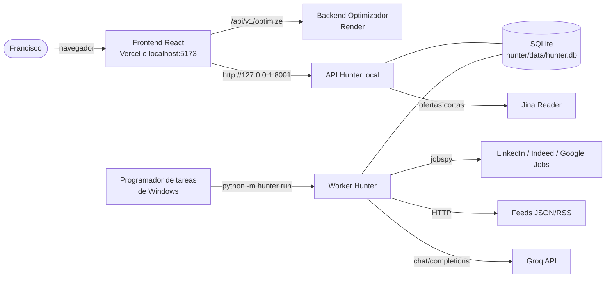
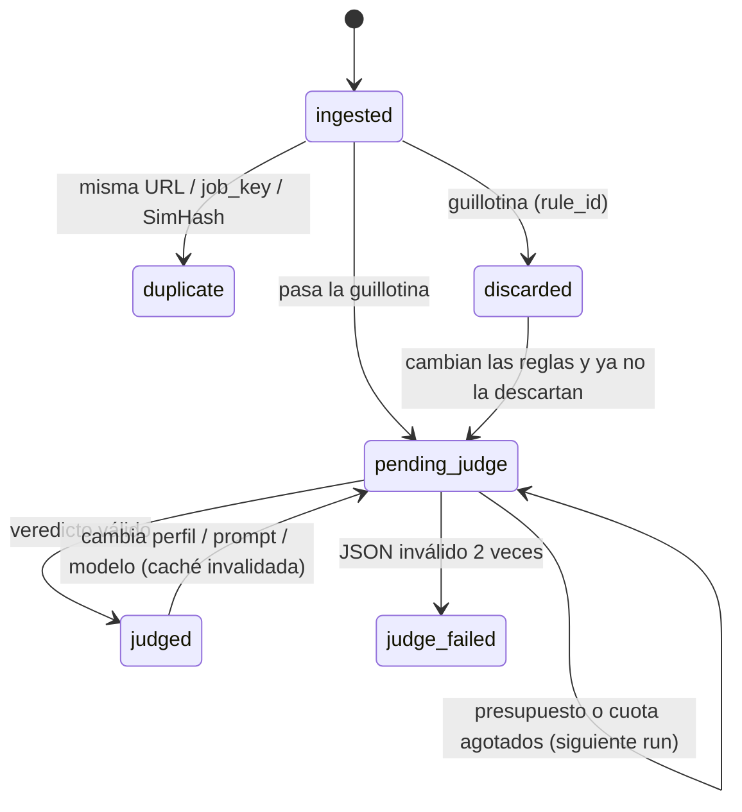

# Job Hunter — Especificación técnica (SPEC)

| Campo | Valor |
|---|---|
| **Proyecto** | CV-Optimizer · módulo **Job Hunter** (buscador y filtrador inverso de empleo con IA) |
| **Tipo de documento** | Especificación técnica (SDD del módulo) |
| **Versión** | 0.2.0 (Fases 1 y 2 implementadas) |
| **Fecha** | 2026-10-15 |
| **Estado** | Aprobado para implementar la Fase 1 |
| **Autor** | Francisco Muñoz Dorado |
| **Relación** | Extiende el [SDD de CV-Optimizer](../SDD.md) (v1.8.0, [ADR-011](../SDD.md#adr-011-job-hunter-local-con-estado-y-juez-ia-solo-para-ranking)) |

### Historial de cambios

| Versión | Fecha | Cambio |
|---|---|---|
| 0.1.0 | 2026-10-15 | Versión inicial tras la auditoría de la Fase 0: worker local + SQLite, deduplicación en 3 capas, guillotina explicable, juez Groq con structured outputs y presupuesto de tokens, puente al Optimizador por `sessionStorage`. |
| 0.1.1 | 2026-10-15 | Ajustes al implementar la Fase 1: jobspy ≥ 1.2 registra los fallos en vez de lanzarlos (se capturan sus logs para detectar bloqueos); la capa 3 de dedup no fusiona títulos con distinto nivel (junior/senior); `remote=false` explícito de Arbeitnow cuenta como presencial; idioma `unknown`; "entre X y Y años"; regla `LOC_FOREIGN_COUNTRY` (en el primer run real, LinkedIn devolvió ofertas de EE. UU. para "España" y pasaban por no indicar modalidad); CLI `rules`, `jobs` y `sources`. |
| 0.2.0 | 2026-10-15 | Fase 2 (juez IA): `LLMVerdict` (lo que se pide) frente a `JobVerdict` (lo que se guarda) con `finalize()`; esquema estricto sin límites de longitud y vuelta a `json_mode` si Groq lo rechaza; citas de ≥ 12 caracteres; juez secuencial; latido de 10 min; caché por `verdict_key` (migración 002); CLI `show`, `rejudge`, `run --retry-failed/--judge-limit`; golden set de 40 ofertas y test live. Run real (16/10/2026): 19/19 ofertas juzgadas con gpt-oss-120b sin 429 ni reparaciones (62.713 tokens), repetición 100 % desde caché (0 tokens), golden live OK con 120b y 20b. Una oferta "USA, remoto" que exigía autorización de trabajo en EE. UU. sacó 78: se amplía `LOC_REMOTE_SCOPE` ("authorization to work in", "work permit for") y el prompt pasa a **v2** con la sección BLOQUEOS (tope de 30 y "skip"); `rules import` re-evalúa también las ya juzgadas. |

---

## Índice

1. [Objetivo y alcance](#1-objetivo-y-alcance)
2. [Decisiones de partida](#2-decisiones-de-partida)
3. [Arquitectura](#3-arquitectura)
4. [Modelos de datos](#4-modelos-de-datos)
5. [Reglas de Oro](#5-reglas-de-oro)
6. [Pipeline en detalle](#6-pipeline-en-detalle)
7. [Juez IA (Fase 2 del pipeline)](#7-juez-ia-fase-2-del-pipeline)
8. [Contratos de la API local](#8-contratos-de-la-api-local)
9. [Resiliencia](#9-resiliencia)
10. [Frontend y puente al Optimizador](#10-frontend-y-puente-al-optimizador)
11. [Seguridad y privacidad](#11-seguridad-y-privacidad)
12. [Configuración](#12-configuración)
13. [Estructura de carpetas](#13-estructura-de-carpetas)
14. [Cambios en el código existente](#14-cambios-en-el-código-existente)
15. [Testing y CI](#15-testing-y-ci)
16. [Plan de implementación en 3 fases](#16-plan-de-implementación-en-3-fases)
17. [Riesgos y mitigaciones](#17-riesgos-y-mitigaciones)

---

## 1. Objetivo y alcance

### 1.1 Problema
Buscar empleo en varios portales obliga a leer decenas de ofertas al día, la mayoría descartables por
motivos objetivos (presencial en otra ciudad, 5 años de experiencia, consultora intermediaria) o por
motivos que solo se ven leyendo con atención (stack inflado, junior con responsabilidades de senior).

### 1.2 Propuesta
Un pipeline **inverso**: en lugar de buscar ofertas, las ofertas se buscan, se filtran y se puntúan
solas, y solo llegan a la vista las que merecen la pena. Desde ahí, **un clic** las lleva al
Optimizador para adaptar el CV.

```
Ingesta multi-portal ─► Normalización ─► Deduplicación ─► Guillotina (0 tokens)
   ─► Pre-score determinista ─► Juez IA (Groq) ─► Ranking ─► "Enviar al Optimizador"
```

### 1.3 Alcance
- Ingesta gratuita: `python-jobspy` (LinkedIn, Indeed, Google Jobs) + feeds públicos JSON/RSS de empleo tech.
- Fase 1 del pipeline: **guillotina determinista** configurable y explicable.
- Fase 2 del pipeline: **juez semántico** en Groq (free tier) con salida validada por Pydantic.
- Vista "Buscador" en el frontend actual: Reglas de Oro, ranking, descartadas, estado de fuentes y botón
  "Enviar al Optimizador".

### 1.4 No-objetivos
- No es multiusuario ni un servicio público: es una herramienta **personal y local**.
- No aplica a ofertas automáticamente ni envía datos a empresas.
- No usa proxies, APIs ni infraestructura de pago (coste 0 €).
- No sustituye ni modifica el contrato de `POST /api/v1/optimize`.

---

## 2. Decisiones de partida

| ID | Decisión | Motivo |
|---|---|---|
| D1 | Modelo del juez: `openai/gpt-oss-120b`, reserva `openai/gpt-oss-20b`. | `llama-3.3-70b-versatile` pasó a Enterprise en octubre de 2026 (ver `backend/app/core/config.py`). |
| D2 | El pipeline corre como **worker local** (PC del usuario, Programador de tareas de Windows) con **SQLite local**, y expone una **API local** en `127.0.0.1:8001`. | IP residencial (menos bloqueos de LinkedIn/Indeed que desde datacenter), datos personales en el equipo, `jobspy`/pandas fuera de Render y Render sin disco persistente. |
| D3 | Paquete nuevo `hunter/` en el monorepo, con dependencias propias. Reutiliza `backend/app` como paquete instalable (`pip install -e ../backend`). | No engordar el backend de Render; reutilizar `GroqProvider`, `text_utils.fold`, `consent_filter`, `job_url_extractor` y el patrón de prompts versionados. |
| D4 | Vista "Buscador" dentro del frontend actual, con cambio de vista por hash (`#/buscar`), sin react-router, cargada con `React.lazy`. | Una sola app; el bundle del Optimizador no crece. |
| D5 | Puente por `sessionStorage['cvopt:handoff']`. | Cero cambios en la API del Optimizador; el texto (hasta 15 000 caracteres) no cabe en una URL. |
| D6 | Diseño preparado para migrar a un worker en la nube (GitHub Actions + BD gratuita) cambiando solo el repositorio de persistencia (`store/`). | Opción B de la Fase 0, aplazada. |

---

## 3. Arquitectura

### 3.1 Contexto (C4 nivel 1)



### 3.2 Contenedores (C4 nivel 2)

| Contenedor | Tecnología | Responsabilidad |
|---|---|---|
| `hunter` CLI | Python 3.12, `python -m hunter ...` | `init`, `run`, `rules show\|export\|import`, `simulate`, `jobs`, `sources`, `purge` (y `serve` en la Fase 3). Lo lanza el Programador de tareas. |
| Pipeline | `hunter.pipeline` | Orquesta las etapas; idempotente y reanudable. |
| Fuentes | `hunter.sources` | Una clase por fuente detrás de la interfaz `JobSource`; aisladas entre sí. |
| Juez | `hunter.judge` | Llamadas a Groq vía `app.services.llm.groq.GroqProvider`, limitador de tokens, caché de veredictos. |
| Persistencia | `hunter.store` (sqlite3 de la stdlib, WAL) | Repositorio único; migraciones con `PRAGMA user_version`. |
| API local | FastAPI + uvicorn en `127.0.0.1:8001` | Lectura de ofertas, reglas, ejecuciones y handoff. |
| Vista Buscador | React 19 + Tailwind 4 (`frontend/src/features/hunter`) | Reglas, ranking, descartadas, fuentes, puente. |

### 3.3 Etapas del pipeline y estado de cada oferta



`duplicate` no se guarda como oferta: se registra como alias (`job_sources`) de la original.

---

## 4. Modelos de datos

### 4.1 Modelos Pydantic (fuente única de verdad)

```python
# hunter/hunter/models.py
from datetime import date, datetime
from typing import Literal

from pydantic import BaseModel, ConfigDict, Field, HttpUrl

Site = Literal["linkedin", "indeed", "google", "remotive", "arbeitnow", "rss"]
Modality = Literal["remote", "hybrid", "onsite", "unknown"]
Language = Literal["es", "en", "other", "unknown"]  # "unknown" nunca descarta
Stage = Literal["discarded", "pending_judge", "judged", "judge_failed"]
AppStatus = Literal["none", "saved", "sent_to_optimizer", "applied", "dismissed"]


class RawJob(BaseModel):
    """Lo que entrega una fuente, ya validado. Una fila que no valida se descarta y se cuenta."""
    model_config = ConfigDict(str_strip_whitespace=True)

    site: Site
    site_job_id: str | None = None
    url: HttpUrl
    title: str = Field(min_length=2, max_length=300)
    company: str = Field(min_length=1, max_length=200)
    location: str = ""
    is_remote: bool | None = None
    date_posted: date | None = None
    description: str = Field(default="", max_length=60_000)
    salary_min: float | None = None
    salary_max: float | None = None
    salary_currency: str | None = None
    salary_interval: Literal["yearly", "monthly", "hourly"] | None = None


class Job(BaseModel):
    id: str                          # uuid4 hex
    job_key: str                     # sha256 de empresa|título|zona normalizados
    desc_sha256: str                 # hash exacto de la descripción normalizada
    simhash: str                     # 16 caracteres hex (64 bits)
    title: str
    company: str
    location: str
    location_bucket: str             # "malaga", "remote", "madrid", "unknown"...
    modality: Modality
    language: Literal["es", "en", "other"]
    description: str                 # limpia (sin banners de cookies ni boilerplate)
    description_chars: int
    date_posted: date | None
    first_seen: datetime
    last_seen: datetime
    times_seen: int
    stage: Stage
    app_status: AppStatus = "none"
    prescore: int = Field(ge=0, le=100)
    rank_score: float | None = None
    sources: list["JobSourceRef"]


class JobSourceRef(BaseModel):
    site: Site
    url: HttpUrl
    seen_at: datetime


class GuillotineResult(BaseModel):
    passed: bool
    rule_id: str | None = None       # p. ej. "EXP_TOO_MANY_YEARS"
    rule_label: str | None = None    # "Pide 5 años (máximo 2)"
    matched_text: str | None = Field(default=None, max_length=200)
    rules_version: str


class Flag(BaseModel):
    model_config = ConfigDict(extra="forbid")
    text: str = Field(min_length=3, max_length=160)
    evidence: str = Field(default="", max_length=200)   # cita literal de la oferta
    evidence_verified: bool = False                      # lo calcula el backend, no el LLM


class JobVerdict(BaseModel):
    """Salida del juez. Todos los campos siempre presentes: la UI nunca recibe null."""
    model_config = ConfigDict(extra="forbid")

    match_score: int = Field(ge=0, le=100)
    verdict: Literal["apply", "maybe", "skip"]
    summary: str = Field(min_length=10, max_length=280)
    green_flags: list[Flag] = Field(default_factory=list, max_length=6)
    red_flags: list[Flag] = Field(default_factory=list, max_length=6)
    stack_core: list[str] = Field(default_factory=list, max_length=12)      # lo que de verdad usarás
    stack_inflated: list[str] = Field(default_factory=list, max_length=12)  # relleno / lista de deseos
    missing_must_haves: list[str] = Field(default_factory=list, max_length=8)
    seniority_detected: Literal["intern", "junior", "mid", "senior", "lead", "unknown"]
    seniority_fit: Literal["under", "fit", "over", "unknown"]


class JudgeRecord(BaseModel):
    status: Literal["ok", "judge_failed"]
    verdict: JobVerdict | None
    model: str
    prompt_version: str
    tokens_in: int
    tokens_out: int
    judged_at: datetime


SourceStatus = Literal["ok", "empty", "blocked", "timeout", "error", "skipped_breaker_open"]


class SourceRun(BaseModel):
    source: str
    status: SourceStatus
    fetched: int = 0
    valid: int = 0
    invalid: int = 0
    duration_ms: int = 0
    error_code: str | None = None
    retry_at: datetime | None = None


class RunCounts(BaseModel):
    fetched: int = 0
    new: int = 0
    duplicates: int = 0
    discarded: int = 0
    pending_judge: int = 0
    judged: int = 0
    judge_failed: int = 0
    cache_hits: int = 0


class Run(BaseModel):
    id: str
    trigger: Literal["scheduler", "api", "cli"]
    mode: Literal["full", "ingest_only", "judge_only"]
    status: Literal["running", "ok", "partial", "failed"]
    started_at: datetime
    finished_at: datetime | None
    rules_version: str
    counts: RunCounts
    tokens_used: int
    budget_exhausted: bool
    sources: list[SourceRun]
```

`partial` = al menos una fuente falló o el presupuesto se agotó, pero el resto terminó bien.

### 4.2 Esquema SQLite

```sql
PRAGMA journal_mode = WAL;
PRAGMA foreign_keys = ON;
-- PRAGMA user_version = 1  (migraciones numeradas en hunter/store/migrations/)

CREATE TABLE jobs (
  id TEXT PRIMARY KEY,
  job_key TEXT NOT NULL,
  desc_sha256 TEXT NOT NULL,
  simhash TEXT NOT NULL,                 -- hex: un uint64 no cabe en INTEGER con signo
  title TEXT NOT NULL, company TEXT NOT NULL, company_norm TEXT NOT NULL,
  location TEXT NOT NULL, location_bucket TEXT NOT NULL,
  modality TEXT NOT NULL, language TEXT NOT NULL,
  description TEXT NOT NULL, description_chars INTEGER NOT NULL,
  salary_min REAL, salary_max REAL, salary_currency TEXT, salary_interval TEXT,
  date_posted TEXT,
  first_seen TEXT NOT NULL, last_seen TEXT NOT NULL, times_seen INTEGER NOT NULL DEFAULT 1,
  stage TEXT NOT NULL, app_status TEXT NOT NULL DEFAULT 'none',
  prescore INTEGER NOT NULL DEFAULT 0, rank_score REAL
);
CREATE INDEX ix_jobs_job_key ON jobs(job_key);
CREATE INDEX ix_jobs_stage_rank ON jobs(stage, rank_score DESC);
CREATE INDEX ix_jobs_last_seen ON jobs(last_seen);

CREATE TABLE job_sources (                -- alias: la misma oferta vista en varias URLs/portales
  job_id TEXT NOT NULL REFERENCES jobs(id) ON DELETE CASCADE,
  site TEXT NOT NULL, site_job_id TEXT,
  url TEXT NOT NULL, url_canonical TEXT NOT NULL UNIQUE,
  seen_at TEXT NOT NULL
);
CREATE UNIQUE INDEX ux_job_sources_site_id ON job_sources(site, site_job_id) WHERE site_job_id IS NOT NULL;

CREATE TABLE guillotine_results (
  job_id TEXT NOT NULL REFERENCES jobs(id) ON DELETE CASCADE,
  rules_version TEXT NOT NULL,
  passed INTEGER NOT NULL, rule_id TEXT, rule_label TEXT, matched_text TEXT,
  evaluated_at TEXT NOT NULL,
  PRIMARY KEY (job_id, rules_version)
);

CREATE TABLE verdicts (                   -- caché de veredictos
  cache_key TEXT PRIMARY KEY,             -- ver §7.5
  job_id TEXT NOT NULL REFERENCES jobs(id) ON DELETE CASCADE,
  status TEXT NOT NULL, verdict_json TEXT,
  model TEXT NOT NULL, prompt_version TEXT NOT NULL,
  tokens_in INTEGER NOT NULL, tokens_out INTEGER NOT NULL,
  created_at TEXT NOT NULL
);
CREATE INDEX ix_verdicts_job ON verdicts(job_id, created_at DESC);

CREATE TABLE rules (
  version TEXT PRIMARY KEY,               -- sha256[:12] del JSON canónico
  json TEXT NOT NULL, created_at TEXT NOT NULL, active INTEGER NOT NULL DEFAULT 0
);

CREATE TABLE runs (
  id TEXT PRIMARY KEY, trigger TEXT NOT NULL, mode TEXT NOT NULL, status TEXT NOT NULL,
  started_at TEXT NOT NULL, finished_at TEXT, heartbeat_at TEXT NOT NULL,
  rules_version TEXT NOT NULL, counts_json TEXT NOT NULL,
  tokens_used INTEGER NOT NULL DEFAULT 0, budget_exhausted INTEGER NOT NULL DEFAULT 0, error TEXT
);

CREATE TABLE source_runs (
  run_id TEXT NOT NULL REFERENCES runs(id) ON DELETE CASCADE,
  source TEXT NOT NULL, status TEXT NOT NULL,
  fetched INTEGER, valid INTEGER, invalid INTEGER, duration_ms INTEGER,
  error_code TEXT, error_message TEXT,
  PRIMARY KEY (run_id, source)
);

CREATE TABLE source_health (              -- circuit breaker por fuente
  source TEXT PRIMARY KEY,
  consecutive_failures INTEGER NOT NULL DEFAULT 0,
  open_until TEXT, last_ok_at TEXT, last_error TEXT
);

CREATE TABLE token_ledger (               -- presupuesto diario (fecha local Europe/Madrid)
  day TEXT PRIMARY KEY, tokens_used INTEGER NOT NULL DEFAULT 0, requests INTEGER NOT NULL DEFAULT 0
);
```

**Retención:** ofertas `discarded` y `judged` sin `app_status` se purgan a los 90 días de `last_seen`
(`python -m hunter purge`, también al final de cada run). Los hashes se conservan en una tabla
mínima `seen_fingerprints(job_key, simhash, desc_sha256, last_seen)` para no re-evaluar ofertas
eternas que siguen repostándose.

---

## 5. Reglas de Oro

### 5.1 Esquema (`GoldenRules`, validado con Pydantic; ejemplo en `hunter/rules.example.json`)

```json
{
  "schema_version": 1,
  "search": {
    "queries": [
      {
        "term": "junior AI engineer",
        "google_term": "junior AI engineer jobs near Málaga since yesterday",
        "location": "Málaga, España",
        "sites": ["linkedin", "indeed", "google"],
        "hours_old": 48,
        "results_wanted": 30,
        "is_remote": null
      },
      { "term": "python developer junior", "location": "España", "sites": ["linkedin", "indeed"], "hours_old": 48, "results_wanted": 30, "is_remote": true }
    ],
    "country_indeed": "spain",
    "feeds": ["remotive", "arbeitnow"]
  },
  "location": {
    "home_area": "malaga",
    "onsite_allowed_areas": ["malaga", "torremolinos", "benalmadena", "fuengirola", "marbella", "rincon de la victoria", "alhaurin de la torre", "campanillas", "velez-malaga"],
    "accept_remote": true,
    "remote_scopes": ["spain", "europe", "emea", "worldwide"],
    "accept_hybrid_outside_area": false,
    "home_countries": ["spain"]
  },
  "experience": { "max_years_required": 2, "unknown_years": "pass" },
  "seniority": { "exclude_title_terms": ["senior", "sr", "lead", "principal", "staff", "head of", "manager", "director", "architect", "arquitecto"] },
  "blacklists": {
    "companies": ["Empresa Ejemplo S.L."],
    "intermediary_signals": ["para importante cliente", "para un importante cliente", "nuestro cliente", "on behalf of our client", "body shopping"],
    "title_terms": ["comercial", "sales", "prácticas no remuneradas"],
    "description_terms": ["autónomo obligatorio", "solo freelance"]
  },
  "required_any": { "terms": ["python", "llm", "inteligencia artificial", "machine learning", "ia generativa", "fastapi", "rag", "nlp"], "min_hits": 1 },
  "languages": { "allowed": ["es", "en"] },
  "salary": { "min_annual_eur": null },
  "freshness": { "max_age_days": 21 },
  "judge": {
    "profile_file": "data/profile.md",
    "priorities": ["aprender IA aplicada en producción", "mentoría", "remoto o Málaga"],
    "soft_dislikes": ["guardias", "más de 1 día presencial fuera de Málaga"],
    "min_score_to_show": 55
  }
}
```

- `rules_version` = `sha256(json canónico)[:12]`. Cada cambio guarda una versión nueva; la anterior queda
  en el historial y se puede restaurar.
- Todas las comparaciones de texto usan `fold()` de `app.services.text_utils` (minúsculas, sin tildes).
- Los términos son palabras/frases completas (límites de palabra), nunca subcadenas: `"ia"` no casa con `"media"`.

### 5.2 Reglas de la guillotina (orden de evaluación: de más barata a más cara)

| Orden | `rule_id` | Descarta si… | Datos |
|---|---|---|---|
| 1 | `BL_COMPANY` | `company_norm` está en `blacklists.companies` (normalizado). | empresa |
| 2 | `STALE` | `date_posted` más antigua que `freshness.max_age_days`. | fecha |
| 3 | `SEN_TITLE` | El título contiene un término de `seniority.exclude_title_terms`. | título |
| 4 | `BL_TITLE_TERM` | El título contiene un término de `blacklists.title_terms`. | título |
| 5 | `LOC_ONSITE_OUT_OF_AREA` | Modalidad `onsite` (o `hybrid` con `accept_hybrid_outside_area=false`) y `location_bucket` fuera de `onsite_allowed_areas`. | ubicación + modalidad |
| 5b | `LOC_FOREIGN_COUNTRY` | La ubicación está en un país fuera de `location.home_countries` (por defecto `["spain"]`; "Knoxville, TN, USA") y la oferta **no** es remota. Sin modalidad no es "duda": una oficina en otro país no es para ti. | ubicación |
| 6 | `LOC_REMOTE_SCOPE` | Remoto restringido a un ámbito no aceptado ("US only", "remote within Germany"), leyendo la ubicación y la descripción. | ubicación + descripción |
| 7 | `LANG_NOT_ALLOWED` | Idioma detectado fuera de `languages.allowed`. | descripción |
| 8 | `EXP_TOO_MANY_YEARS` | Años exigidos > `experience.max_years_required` (ver §6.4). | descripción |
| 9 | `BL_INTERMEDIARY` | Señales de intermediaria/consultora en la descripción. | descripción |
| 10 | `BL_DESC_TERM` | Término excluyente en la descripción. | descripción |
| 11 | `SAL_BELOW_MIN` | Salario anual máximo conocido < `salary.min_annual_eur` (si está definido). Sin salario ⇒ pasa. | salario |
| 12 | `REQ_ANY_MISSING` | Menos de `min_hits` términos de `required_any` en título + descripción. | todo |

- **Modo normal:** cortocircuito en la primera regla que descarta (rápido).
- **Modo explicación/simulación:** evalúa todas y devuelve la lista completa de reglas que dispararían.
- **Ante la duda, pasa:** si un dato falta (sin fecha, sin ubicación, sin años) la regla **no** descarta.
  Un falso negativo (perder una buena oferta) es peor que gastar unos tokens.
- Toda oferta descartada guarda `rule_id`, `rule_label` legible y `matched_text` (≤ 200 caracteres) para la
  vista "Descartadas".

---

## 6. Pipeline en detalle

### 6.1 Ingesta

**Interfaz común:**

```python
class JobSource(ABC):
    name: str                       # "linkedin", "remotive"...
    timeout_s: float

    @abstractmethod
    async def fetch(self, query: SearchQuery) -> list[RawJob]:
        """Lanza SourceBlockedError / SourceTimeoutError / SourceError; nunca devuelve basura."""
```

**Fuentes de la v0.1:**

| Fuente | Implementación | Notas |
|---|---|---|
| `linkedin`, `indeed`, `google` | `JobspySource(site)`: `scrape_jobs(site_name=[site], ...)` **una llamada por portal**, ejecutada en `asyncio.to_thread` con `asyncio.wait_for(timeout)`. | `fetch_description=True` (sin descripción no hay guillotina útil). Desde jobspy 1.2 los portales no lanzan excepciones: registran el fallo en su logger (`JobSpy:LinkedIn`...), así que se captura ese log para distinguir `blocked` (429/403/999, "blocked?") de `empty`. `country_indeed="spain"`. `results_wanted` bajo (≤ 30), `hours_old=48`. Import perezoso de `jobspy` (extra opcional `scrape`). Se mapean las columnas del DataFrame a `RawJob` fila a fila; las que no validan se cuentan en `invalid`. |
| `remotive` | `GET https://remotive.com/api/remote-jobs?category=software-dev` | JSON público; respetar su política (atribución y pocas peticiones al día). |
| `arbeitnow` | `GET https://www.arbeitnow.com/api/job-board-api` | JSON público paginado; filtra Europa. |
| `rss` | `feedparser` sobre URLs configurables | Para portales con RSS propio. |

Antes de activar una fuente se revisan sus condiciones de uso; el uso es personal y de bajo volumen.

**Ejecución:** `asyncio.gather(*tareas, return_exceptions=True)`, cada tarea envuelta en
`run_source()` que traduce cualquier excepción a un `SourceRun` con su estado (§9). Entre llamadas a un
mismo portal (varias búsquedas) se espera 3–8 s con jitter.

**Clasificación de errores de jobspy:** el texto/código de la excepción se mapea a
`blocked` (429, 403, 999 de LinkedIn, "rate limit", captcha), `timeout` o `error`. Un DataFrame vacío
es `empty` (no cuenta como fallo para el circuit breaker, salvo 3 vacíos seguidos en LinkedIn, que
suelen indicar bloqueo silencioso).

### 6.2 Normalización

1. `description`: `strip_consent_noise()` (de `app.services.consent_filter`) + quitar Markdown/HTML +
   colapsar espacios + recortar boilerplate de pie (bloques "Sobre nosotros/Igualdad de oportunidades"
   solo para el hash, no para mostrar).
2. `company_norm`: `fold()`, sin sufijos societarios (`s.l.`, `sl`, `s.a.`, `slu`, `inc`, `ltd`, `gmbh`,
   `group`, `grupo`), sin puntuación.
3. `title_norm`: `fold()`, sin marcadores de género/diversidad (`(m/f/d)`, `(h/m)`, `(f/m/x)`), sin
   ubicación entre paréntesis ni prefijos tipo "Oferta:". El nivel (junior/senior) **se conserva**.
4. `location_bucket`: municipio/provincia conocidos (tabla de alias: "Málaga, Andalucía, España" → `malaga`);
   "Remote"/"Remoto"/"Teletrabajo" → `remote`; si no se reconoce, `unknown`.
5. `modality`: `is_remote` de la fuente + regex bilingüe sobre título y descripción:
   remoto (`100% remoto`, `teletrabajo`, `remote-first`, `fully remote`), híbrido (`híbrido`, `hybrid`,
   `x días en oficina`), presencial (`presencial`, `on-site`, `in office`). Título y ubicación mandan;
   si la descripción menciona remoto y presencial a la vez, se toma como híbrido. `is_remote=False`
   solo cuenta como presencial en fuentes donde es un dato explícito (Arbeitnow): en jobspy es el valor
   por defecto.
6. `language`: `detect_language()` de `app.services.output_validator` (es/en) más una heurística de
   palabras frecuentes para marcar como `other` las ofertas en alemán/francés; si no se sabe, `unknown`.
7. URL canónica: esquema+host en minúsculas, sin fragmento, sin parámetros de seguimiento (`utm_*`,
   `trk`, `trackingId`, `refId`, `from`, `src`, `gclid`, `fbclid`), y para LinkedIn/Indeed reducida a su
   identificador (`/jobs/view/{id}`, `viewjob?jk={id}`).

### 6.3 Deduplicación en 3 capas

| Capa | Clave | Coste | Detecta |
|---|---|---|---|
| 1. Identidad de origen | `url_canonical` y `(site, site_job_id)` | Índice único | La misma oferta vista otra vez en el mismo portal. |
| 2. Huella estable | `job_key = sha256(company_norm \| title_norm \| location_bucket)` | Índice | Reposteo con otra URL o en otro portal. |
| 3. Huella de contenido | `simhash` de 64 bits de la descripción normalizada | Escaneo de las ofertas de los últimos 60 días | Misma oferta con el texto ligeramente cambiado (o con otro título). |

**SimHash:** tokens = `tokens(fold(descripción))` sin stopwords (reutiliza `STOPWORDS` de
`app.services.text_utils`); shingles de 3 palabras; hash de cada shingle con
`hashlib.blake2b(digest_size=8)`; vector de 64 contadores ponderados por frecuencia; bit = 1 si el
contador > 0. Implementación propia en Python puro (~40 líneas), sin dependencias.

**Algoritmo de decisión** para cada `RawJob`:

1. Capa 1 coincide → actualizar `last_seen`, `times_seen += 1`; fin (`duplicate`).
2. Capa 2 coincide con una oferta vista en los últimos 60 días **y** Hamming(simhash) ≤ 12 → alias
   (`job_sources`) de la existente; fin. (Si la distancia es mayor, es un puesto distinto con el mismo
   título en la misma empresa: oferta nueva.)
3. Capa 3: Hamming ≤ 3 con cualquier oferta de los últimos 60 días → alias; fin. **Excepción:** si los
   dos títulos declaran niveles distintos (becario/junior/senior), no se fusionan: hay empresas que
   reutilizan la descripción, y si llegara antes la senior (descartada) la junior se perdería.
4. Si no, oferta nueva → guillotina.

Con unos cientos de ofertas, el escaneo lineal de la capa 3 cuesta milisegundos. Si se superan ~20 000,
se indexa por 4 bandas de 16 bits (cualquier par a distancia ≤ 3 comparte al menos una banda).

**Antigüedad gratis:** `first_seen` y `times_seen` permiten señales deterministas ("publicada hace 40
días y reposteada 6 veces") que se muestran en la tarjeta y se pasan al juez como contexto.

### 6.4 Detección de años de experiencia

Sobre la descripción **original** (con tildes para leer, `fold()` para comparar), frase a frase:

- **Español:** `(\d{1,2})\s*(?:\+|o más)?\s*(?:(?:-|a)\s*(\d{1,2}))?\s*años?\s+(?:de\s+)?experiencia`,
  `experiencia\s+(?:mínima\s+)?(?:de\s+)?(?:al menos\s+)?(\d{1,2})\s*años`,
  `(?:mínimo|al menos)\s+(\d{1,2})\s*años`.
- **Inglés:** `(\d{1,2})\s*\+?\s*(?:(?:-|to)\s*(\d{1,2}))?\s*(?:years?|yrs?)\s+(?:of\s+)?(?:[\w#+.-]+\s+){0,3}experience`,
  `(?:at least|minimum(?: of)?)\s+(\d{1,2})\s*(?:years?|yrs?)`.
- **Números en letra:** uno…diez / one…ten → dígitos antes de aplicar los patrones.
- **Rangos:** "3-5 años" y "entre 3 y 5 años" cuentan como 3 (el mínimo exigido).
- **Números de 4 cifras** ("fundada en 2023") nunca se leen como años de experiencia; por encima de 15
  años se asume que habla de la empresa.
- **Varios valores:** se toma el **máximo** de los mínimos de frases obligatorias.
- **Frases opcionales ignoradas:** si la frase contiene `valorable`, `se valorará`, `deseable`, `plus`,
  `nice to have`, `preferred`, `bonus`, no cuenta.
- Sin coincidencias → `unknown` → la regla pasa (`experience.unknown_years = "pass"`).

Cada patrón tiene una tabla de casos en `tests/test_experience.py` (positivos, negativos y trampas como
"empresa con 15 años de experiencia en el sector").

### 6.5 Pre-score determinista (0 tokens)

`prescore` 0–100 = cobertura de los términos del perfil (`required_any.terms` + skills extraídas de
`data/profile.md`) en la oferta, con `contains()` de `app.services.match_scorer`, más un pequeño bonus
por modalidad preferida y frescura. Sirve para **ordenar la cola del juez** (las mejores primero) y como
desempate. No se muestra como "score" principal.

---

## 7. Juez IA (Fase 2 del pipeline)

### 7.1 Entrada
- Prompts versionados: `hunter/hunter/prompts/judge_system.v1.md` y `judge_user.v1.md`.
- Contexto: perfil (`data/profile.md`, resumen del CV escrito por el usuario), `judge.priorities`,
  `judge.soft_dislikes`, señales deterministas ya calculadas (modalidad, ubicación, años detectados,
  `times_seen`, días publicada).
- Oferta: título, empresa, ubicación y descripción limpia **truncada a `HUNTER_JUDGE_MAX_INPUT_CHARS`**
  (6 000 por defecto, cortando por párrafo), delimitada y escapada con `escape_user_data()` de
  `app.services.prompt_builder`. El system prompt incluye la sección SEGURIDAD de los prompts actuales:
  el texto de la oferta es dato, nunca instrucciones.

### 7.2 Instrucciones clave del prompt
- Puntuar **encaje con el perfil**, no calidad de la oferta.
- `stack_core` = tecnologías que aparecen en responsabilidades/tareas; `stack_inflated` = las que solo
  aparecen en listas de requisitos sin relación con las tareas, o combinaciones implausibles para el
  nivel ("junior" con 12 tecnologías obligatorias).
- Cada `red_flag` debe llevar `evidence` = cita literal (≤ 200 caracteres) de la oferta.
- Red flags típicas a vigilar: salario oculto con "muy competitivo", "ambiente familiar", guardias, rol
  junior con responsabilidades de lead, mezcla de puestos (dev + soporte + comercial), reposteo continuo.
- Rúbrica del `match_score`: 85–100 aplicar ya; 65–84 encaje con huecos asumibles; 40–64 dudoso; < 40 no.

### 7.3 Salida estricta
1. Petición con **Structured Outputs** de Groq:
   `response_format = {"type": "json_schema", "json_schema": {"name": "job_verdict", "strict": true, "schema": S}}`,
   donde `S = to_strict_schema(LLMVerdict)`: el modelo que se pide al LLM (todas las propiedades
   `required`, `additionalProperties: false`, sin `evidence_verified`, que es de servidor, y **sin
   límites de longitud**: `maxLength`/`maxItems` no siempre los admite el modo estricto, así que los
   aplica `finalize()` recortando en vez de fallar). Si Groq rechaza la petición con esquema, el juez
   sigue con `json_mode` el resto del run y la validación Pydantic hace de red.
2. `LLMVerdict.model_validate_json()`. Si falla (o Groq devuelve `json_validate_failed`) → una llamada
   de reparación (prompt `judge_repair.v1.md`, incluye el error de validación concreto).
3. Si vuelve a fallar → `judge_failed` (se guarda el error); la oferta aparece sin score y
   `run --retry-failed` (o el botón "Reintentar juicio" en la UI) la devuelve a la cola. Un fallo nunca
   se sirve desde la caché.
4. **Post-validación determinista** (`finalize()`, mismo espíritu que ADR-010: el estilo se tolera, los
   hechos no):
   - Puntuación acotada a 0–100; textos y listas recortados a su máximo.
   - `evidence_verified = True` solo si la cita aparece en la descripción (sin tildes, mayúsculas,
     comillas ni espacios extra) y tiene al menos 12 caracteres ("Python" no prueba nada). Una flag
     sin evidencia verificada se muestra atenuada con "sin cita verificable".
   - Coherencia: `verdict="apply"` con `match_score < 50` → `maybe`; `verdict="skip"` con
     `match_score ≥ 75` → `maybe`.
   - Listas deduplicadas y recortadas a su máximo; tecnologías normalizadas (`fold`).
5. `rank_score = 0.8 * match_score + 0.2 * prescore` (desempate: `last_seen` más reciente).

### 7.4 Protección de rate-limits y presupuesto

```
cola (orden: prescore desc, de una en una)
     ─► caché de veredictos (acierto = 0 tokens)
     ─► BudgetGuard (tokens del día < HUNTER_DAILY_TOKEN_BUDGET)
     ─► AdaptiveLimiter.acquire(coste estimado) ─► GroqProvider.complete()
     ─► AdaptiveLimiter.observe(cabeceras x-ratelimit-*)
```

- **`AdaptiveLimiter`** (token bucket): parte de valores conservadores configurables y se ajusta con
  las cabeceras que devuelve Groq en cada respuesta:
  `x-ratelimit-remaining-requests` / `x-ratelimit-reset-requests` (cuota diaria de peticiones) y
  `x-ratelimit-remaining-tokens` / `x-ratelimit-reset-tokens` (tokens por minuto). Los resets vienen
  como duración (`"7.66s"`, `"2m59.56s"`) y se parsean a segundos.
  Coste estimado de una llamada = `len(prompt) / 3.5 + max_output_tokens`. Si no cabe, espera hasta el
  reset (máximo 60 s por espera); así el 429 es la excepción y no la norma.
- **Reintentos:** los de `GroqProvider` (backoff exponencial con jitter, `Retry-After` ≤ 10 s, modelo
  de reserva). Si ambos modelos devuelven 429 con un `Retry-After` largo (cuota diaria), el juez se
  **detiene** para esta ejecución: las ofertas restantes quedan en `pending_judge` y el run termina en
  `partial` con `budget_exhausted=true`.
- **`BudgetGuard`:** suma `tokens_in + tokens_out` en `token_ledger` (día local Europe/Madrid). Al
  alcanzar `HUNTER_DAILY_TOKEN_BUDGET` se para igual que arriba.
- **Sin batching:** 1 oferta = 1 llamada pequeña. Agrupar varias ofertas en un prompt empeora la calidad
  y un JSON roto invalidaría el lote entero.
- **`reasoning_effort = "low"`** y `max_tokens = HUNTER_JUDGE_MAX_OUTPUT_TOKENS` (2 048): en gpt-oss el
  razonamiento consume tokens de salida.

### 7.5 Caché de veredictos

```
cache_key = sha256(desc_sha256 | judge_context_hash | prompt_version | model_family)
judge_context_hash = sha256(perfil normalizado | judge.priorities | judge.soft_dislikes)
model_family = "gpt-oss"   (120b y 20b comparten caché; el modelo real queda en `verdicts.model`)
```

- Cambiar las reglas de la guillotina **no** invalida veredictos (no afectan al juez); cambiar el perfil,
  las prioridades o el prompt, sí.
- Las ofertas duplicadas (§6.3) nunca llegan al juez; una oferta que reaparece un día después con otra
  URL reutiliza el veredicto existente: **0 tokens**.
- `POST /api/v1/jobs/{id}/rejudge` fuerza una evaluación nueva (ignora la caché, respeta el presupuesto).

---

## 8. Contratos de la API local

Base: `http://127.0.0.1:8001`. Prefijo `/api/v1` (como el backend). Todas las rutas salvo `/health`
exigen la cabecera `X-Hunter-Token` (§11). Errores con el mismo formato que el backend
(`ErrorResponse` de `app.schemas.optimize`):

```json
{ "error": { "code": "RUN_IN_PROGRESS", "message": "Ya hay una búsqueda en marcha.", "request_id": "6c1f..." } }
```

### `GET /health`
```json
{ "status": "ok", "version": "0.1.0", "db_ok": true, "groq_key_configured": true,
  "last_run": { "id": "a1b2...", "status": "partial", "finished_at": "2026-10-16T08:34:12+02:00" } }
```

### `GET /api/v1/rules`
```json
{ "version": "3f9c0a1b22de", "created_at": "2026-10-16T09:00:00+02:00", "rules": { "...": "GoldenRules" },
  "history": [ { "version": "1a2b3c4d5e6f", "created_at": "2026-10-15T20:10:00+02:00" } ] }
```

### `PUT /api/v1/rules`
Cuerpo: `{ "rules": GoldenRules }`. Valida, guarda una versión nueva y la activa. Las ofertas
`discarded` de los últimos 7 días se re-evalúan con las reglas nuevas (0 tokens) y las que ahora pasan
vuelven a `pending_judge`.
```json
{ "version": "77aa01bc93f0", "reevaluated": 142, "now_pending_judge": 9 }
```
Errores: `422 RULES_INVALID` (con `details`: lista de `{path, message}` de Pydantic).

### `POST /api/v1/rules/simulate`
Cuerpo: `{ "rules": GoldenRules, "window_days": 7 }`. No guarda nada ni gasta tokens.
```json
{
  "window_days": 7, "total": 318,
  "current":  { "kept": 41, "discarded": 277 },
  "proposed": { "kept": 35, "discarded": 283 },
  "newly_discarded": [ { "job_id": "...", "title": "Python Developer", "company": "Acme", "rule_id": "EXP_TOO_MANY_YEARS", "rule_label": "Pide 3 años (máximo 2)" } ],
  "newly_kept": [],
  "by_rule": { "LOC_ONSITE_OUT_OF_AREA": 121, "EXP_TOO_MANY_YEARS": 64, "SEN_TITLE": 50 }
}
```

### `POST /api/v1/runs`
Cuerpo: `{ "mode": "full" | "ingest_only" | "judge_only" }`. Respuesta `202`:
```json
{ "run_id": "a1b2c3...", "status": "running" }
```
Errores: `409 RUN_IN_PROGRESS` (hay otro run con `heartbeat_at` de hace < 10 min).

### `GET /api/v1/runs/{id}` · `GET /api/v1/runs?limit=10`
Devuelve `Run` (§4.1). Ejemplo resumido:
```json
{ "id": "a1b2...", "status": "partial", "mode": "full", "trigger": "scheduler",
  "counts": { "fetched": 87, "new": 23, "duplicates": 64, "discarded": 15, "pending_judge": 0, "judged": 8, "judge_failed": 0, "cache_hits": 3 },
  "tokens_used": 21450, "budget_exhausted": false,
  "sources": [
    { "source": "linkedin", "status": "blocked", "error_code": "HTTP_429", "retry_at": "2026-10-16T14:30:00+02:00", "fetched": 0 },
    { "source": "indeed", "status": "ok", "fetched": 30, "valid": 29, "invalid": 1, "duration_ms": 8120 }
  ] }
```

### `GET /api/v1/sources`
Estado del circuit breaker por fuente: `[{ "source", "state": "closed"|"open"|"half_open", "consecutive_failures", "open_until", "last_ok_at", "last_error" }]`.

### `GET /api/v1/jobs`
Parámetros: `view=ranked|pending|discarded|failed|all` (por defecto `ranked`), `app_status`, `min_score`,
`q` (texto), `limit` (≤ 100, por defecto 30), `cursor` (opaco).
```json
{
  "items": [
    {
      "id": "9f2e...", "title": "Junior AI Engineer", "company": "Acme", "location": "Málaga", "modality": "hybrid",
      "stage": "judged", "app_status": "none", "rank_score": 82.4, "prescore": 70,
      "first_seen": "2026-10-14T08:31:00+02:00", "times_seen": 2, "days_published": 3,
      "sources": [ { "site": "linkedin", "url": "https://www.linkedin.com/jobs/view/123" } ],
      "verdict": {
        "match_score": 86, "verdict": "apply", "summary": "Rol junior real con Python y RAG; mentoría explícita.",
        "green_flags": [ { "text": "Mentoría y formación", "evidence": "plan de mentoría con un senior", "evidence_verified": true } ],
        "red_flags": [], "stack_core": ["python", "fastapi", "rag"], "stack_inflated": ["kubernetes"],
        "missing_must_haves": [], "seniority_detected": "junior", "seniority_fit": "fit"
      },
      "judge_status": "ok",
      "guillotine": null
    }
  ],
  "next_cursor": null
}
```
En `view=discarded`, `verdict` es `null` y `guillotine` = `{ "rule_id", "rule_label", "matched_text" }`.
En `judge_failed`, `verdict` es `null` y `judge_status = "judge_failed"`. **Las listas nunca son `null`.**

### `GET /api/v1/jobs/{id}`
Igual que un item, más `description` completa y el historial de veredictos (`verdict_history`, máx. 5).
`404 JOB_NOT_FOUND`.

### `PATCH /api/v1/jobs/{id}`
Cuerpo: `{ "app_status": "saved" | "applied" | "dismissed" | "none" }` → item actualizado.

### `POST /api/v1/jobs/{id}/rejudge`
`202 { "job_id", "status": "pending_judge" }`. `429 JUDGE_BUDGET_EXHAUSTED` si no queda presupuesto hoy.

### `GET /api/v1/jobs/{id}/handoff`
Prepara el texto para el Optimizador. Si la descripción tiene < 200 caracteres, intenta completarla con
`extract_job_offer()` de `app.services.job_url_extractor` (Jina Reader) sobre la URL de la oferta.
```json
{ "version": 1, "text": "Junior AI Engineer — Acme (Málaga, híbrido)\n\n...", "chars": 3812,
  "title": "Junior AI Engineer", "company": "Acme", "source_url": "https://www.linkedin.com/jobs/view/123",
  "language": "es", "complete": true }
```
- `text` empieza por una cabecera `título — empresa (ubicación, modalidad)` para que el Optimizador
  tenga contexto, y se recorta a 15 000 caracteres.
- `complete=false` si sigue por debajo de 200 caracteres: la UI avisa y ofrece abrir la oferta.
- Marca la oferta como `app_status = "sent_to_optimizer"`.

### Catálogo de errores

| HTTP | `code` | Cuándo |
|---|---|---|
| 401 | `HUNTER_TOKEN_INVALID` | Falta o no coincide `X-Hunter-Token`. |
| 404 | `JOB_NOT_FOUND` / `RUN_NOT_FOUND` | Id inexistente. |
| 409 | `RUN_IN_PROGRESS` | Ya hay un run vivo. |
| 422 | `RULES_INVALID` | Reglas que no validan. |
| 429 | `JUDGE_BUDGET_EXHAUSTED` | Sin presupuesto de tokens hoy. |
| 503 | `GROQ_KEY_MISSING` | No hay `GROQ_API_KEY` y se pide juzgar. |
| 500 | `INTERNAL_ERROR` | Cualquier otro (con `request_id`, sin trazas al cliente). |

---

## 9. Resiliencia

| Fallo | Comportamiento |
|---|---|
| Un portal bloquea (429/403/999/captcha) | Esa fuente → `blocked`; el resto sigue. `consecutive_failures += 1`. |
| 3 fallos seguidos de una fuente (`HUNTER_BREAKER_THRESHOLD`) | Circuit breaker **abierto** 6 h (`HUNTER_BREAKER_COOLDOWN_H`, doble en cada reapertura, máx. 48 h). Los runs la marcan `skipped_breaker_open`. Tras el enfriamiento, **half-open**: 1 intento; si va bien, se cierra. |
| Una fuente tarda demasiado | `asyncio.wait_for(HUNTER_SOURCE_TIMEOUT_S=90)` → `timeout`. El hilo de jobspy puede seguir vivo; su resultado se ignora. |
| Filas corruptas | Validación `RawJob` fila a fila: se cuentan en `invalid` y se registran (sin texto completo). |
| Groq 429/5xx puntual | Reintentos de `GroqProvider` + modelo de reserva. |
| Cuota diaria de Groq o presupuesto agotados | El juez se detiene limpio; `pending_judge` se retoma en el siguiente run. |
| JSON inválido del juez | Reparación 1 vez → `judge_failed` (la UI no se rompe). |
| El PC se apaga a mitad de run | Cada oferta se confirma en su propia transacción; el siguiente run ve un `running` sin latido (> 10 min: entre dos latidos del juez caben una espera del limitador y una llamada) y lo marca `failed` antes de empezar. Reanudable: nada se procesa dos veces. |
| La API local no está arrancada | La vista Buscador muestra cómo arrancarla (`python -m hunter serve`); el Optimizador no se ve afectado. |

**Idempotencia:** volver a ejecutar un run con los mismos datos no crea ofertas, no duplica veredictos y
no gasta tokens (capa 1 de dedup + caché de veredictos).

**Observabilidad:** logs JSON en una línea como el backend (`app.core.logging`), en
`hunter/data/logs/hunter-YYYY-MM-DD.log` con rotación de 14 días. Nunca se registran la clave de Groq,
el token local ni el perfil.

---

## 10. Frontend y puente al Optimizador

### 10.1 Navegación
- `src/lib/route.ts`: `useHashRoute()` → `'optimizar' | 'buscar'` (por defecto `optimizar`; `#/buscar`).
- `App.tsx` mantiene el Optimizador tal cual y añade `const HunterView = lazy(() => import('./features/hunter/HunterView'))`.
- La pestaña "Buscador" del `Header` solo aparece con `VITE_HUNTER_ENABLED=true` (local) o tras visitar
  `?hunter=1` una vez (se recuerda en `localStorage['cvopt:hunter']`). En la web pública queda oculta.

### 10.2 Vista Buscador (`frontend/src/features/hunter/`)

| Componente | Función |
|---|---|
| `HunterView` | Contenedor: comprueba `/health`, pide el token la primera vez (guardado en `sessionStorage`, opción "recordar" en `localStorage`), pestañas. |
| `ConnectionGate` | Si la API local no responde: instrucciones (`python -m hunter serve`) y botón "Reintentar". |
| `RunPanel` | Botón "Buscar ahora", progreso del run (sondeo de `GET /runs/{id}` cada 2 s solo mientras `running`), último run, presupuesto de tokens del día. |
| `SourceStatusBar` | Una pastilla por fuente: ok / bloqueada (reintento HH:MM) / desactivada. |
| `JobBoard` | Pestañas: **Ranking** (`judged`, ≥ `min_score_to_show`), **Pendientes**, **Descartadas** (con `rule_label` y `matched_text`, botón "Era buena: ¿qué regla relajo?"), **Fallidas**. Filtro por texto y estado. |
| `JobCard` | Puntuación, veredicto, resumen, green/red flags con su cita (las no verificadas atenuadas), `stack_core` vs `stack_inflated`, antigüedad y reposteos, enlaces a las fuentes, acciones: Guardar · Descartar · Aplicada · **Enviar al Optimizador**. |
| `RulesEditor` | Formulario por secciones de `GoldenRules` (chips para listas), vista JSON avanzada, botón **Simular** (muestra el diff de `rules/simulate`) y **Guardar**. Historial de versiones con "Restaurar". |
| `hunterClient.ts` | `fetch` tipado con `AbortController`, base `VITE_HUNTER_URL` (por defecto `http://127.0.0.1:8001`), cabecera `X-Hunter-Token`, parseo defensivo (listas vacías por defecto). |
| `types.ts` | Tipos espejo de §4 y §8, mantenidos a mano como `src/types/api.ts`. |

Diseño en la línea "la mesa del corrector": cada oferta es una **ficha** sobre la mesa; la puntuación se
marca con rotulador; las red flags subrayadas en ámbar; "Enviar al Optimizador" hace volar la ficha al
tablero de pinza. Las capturas se revisan antes de publicar (acuerdo de trabajo vigente).

### 10.3 Contrato del handoff

```ts
// src/lib/handoff.ts
export interface OfferHandoff {
  version: 1
  text: string            // 200..15000 caracteres
  title: string
  company: string
  sourceUrl?: string
  language?: 'es' | 'en'
  createdAt: number       // Date.now()
}
export const HANDOFF_KEY = 'cvopt:handoff'
export function writeHandoff(h: OfferHandoff): void
export function consumeHandoff(): OfferHandoff | null  // valida forma, versión, longitud y antigüedad (< 10 min); siempre borra la clave
```

**Flujo de "Enviar al Optimizador":**
1. `GET /api/v1/jobs/{id}/handoff` → si `complete=false`, aviso "La oferta es un extracto: ábrela y pega
   el texto completo" con enlace; no se envía.
2. `writeHandoff(...)` y `location.hash = '#/optimizar'`.
3. `App.tsx`, al entrar en la ruta `optimizar`, llama a `consumeHandoff()`; si hay datos:
   `setJobOffer(stripConsentNoise(h.text))`, `language` → `h.language ?? 'auto'`, toast
   "Oferta de {company} importada desde el Buscador" y scroll a la sección 2.
4. Si el usuario ya tenía texto en la oferta, se pregunta antes de sustituirlo.

No cambia nada en `POST /api/v1/optimize` ni en `useOptimize`.

---

## 11. Seguridad y privacidad

- La API local escucha **solo en `127.0.0.1`**. Nunca en `0.0.0.0`.
- **Token local** (`HUNTER_TOKEN`, 32 bytes aleatorios generados por `python -m hunter init`) obligatorio
  en la cabecera `X-Hunter-Token`. Al ser una cabecera personalizada, el navegador hace *preflight* CORS:
  una web cualquiera no puede lanzar runs ni leer datos (protección CSRF hacia localhost).
- CORS restringido a `HUNTER_ALLOWED_ORIGINS` (`http://localhost:5173`, `http://127.0.0.1:5173` y,
  si se quiere usar desde la web desplegada, `https://cv-optimizer-gilt.vercel.app`). Chrome pedirá
  permiso de "acceso a la red local" al llamar a `127.0.0.1` desde la web pública: es esperado.
- `hunter/data/` (BD, perfil, logs) está en `.gitignore`. En el repo solo `rules.example.json` y
  `profile.example.md` sin datos reales.
- La clave de Groq va en `hunter/.env` (gitignored) como `SecretStr`; no viaja al navegador.
- El texto de las ofertas es **no confiable**: delimitado y escapado en el prompt; en la UI se renderiza
  como texto plano (sin `dangerouslySetInnerHTML`; si se usa Markdown, con `rehype-sanitize` como hoy).
- Volumen de scraping bajo y para uso personal; sin rotación de IPs ni evasión de captchas.

---

## 12. Configuración

`hunter/.env` (plantilla en `hunter/.env.example`), leído con `pydantic-settings`:

| Variable | Por defecto | Descripción |
|---|---|---|
| `GROQ_API_KEY` | — | Clave personal de Groq. Sin ella, el pipeline funciona hasta la guillotina. |
| `GROQ_MODEL_PRIMARY` / `GROQ_MODEL_FALLBACK` | `openai/gpt-oss-120b` / `openai/gpt-oss-20b` | Igual que el backend. |
| `HUNTER_DB_PATH` | `data/hunter.db` | Ruta de SQLite. |
| `HUNTER_HOST` / `HUNTER_PORT` | `127.0.0.1` / `8001` | API local. |
| `HUNTER_TOKEN` | (lo genera `init`) | Token local. |
| `HUNTER_ALLOWED_ORIGINS` | `http://localhost:5173,http://127.0.0.1:5173` | CORS. |
| `HUNTER_DAILY_TOKEN_BUDGET` | `150000` | Tokens/día para el juez (ajustar a la cuota real del plan en console.groq.com). |
| `HUNTER_TOKENS_PER_MINUTE` | `6000` | Punto de partida del limitador; se ajusta solo con `x-ratelimit-limit-tokens`. (El juez es secuencial: en el free tier la concurrencia no aporta nada.) |
| `HUNTER_JUDGE_TIMEOUT_S` | `60` | Timeout de cada llamada a Groq. |
| `HUNTER_JUDGE_MAX_INPUT_CHARS` | `6000` | Recorte de la descripción. |
| `HUNTER_JUDGE_MAX_OUTPUT_TOKENS` | `2048` | Incluye el razonamiento de gpt-oss. |
| `HUNTER_REASONING_EFFORT` | `low` | Igual que el backend. |
| `HUNTER_SOURCE_TIMEOUT_S` | `90` | Timeout por fuente. |
| `HUNTER_BREAKER_THRESHOLD` / `HUNTER_BREAKER_COOLDOWN_H` | `3` / `6` | Circuit breaker. |
| `HUNTER_RETENTION_DAYS` | `90` | Purga. |
| `JINA_API_KEY` | — | Opcional, para completar ofertas cortas. |

Frontend (`frontend/.env.local`): `VITE_HUNTER_ENABLED=true`, `VITE_HUNTER_URL=http://127.0.0.1:8001`.

---

## 13. Estructura de carpetas

```
cv-optimizer/
├── backend/                       # sin cambios funcionales (ver §14)
├── frontend/
│   └── src/
│       ├── features/hunter/       # NUEVO: HunterView, componentes, hunterClient.ts, types.ts, tests
│       └── lib/
│           ├── handoff.ts         # NUEVO
│           └── route.ts           # NUEVO
├── hunter/                        # NUEVO paquete Python
│   ├── SPEC.md                    # este documento
│   ├── README.md                  # instalación, init, Programador de tareas
│   ├── pyproject.toml             # deps + extras [scrape] (python-jobspy) y [dev]
│   ├── .env.example
│   ├── rules.example.json
│   ├── profile.example.md
│   ├── scripts/
│   │   └── install_task.ps1       # registra las tareas diarias en el Programador de tareas
│   ├── data/                      # gitignored: hunter.db, profile.md, logs/
│   ├── hunter/
│   │   ├── __main__.py            # CLI: init | run | serve | simulate | purge | export
│   │   ├── config.py              # Settings (pydantic-settings)
│   │   ├── models.py              # §4.1
│   │   ├── rules/
│   │   │   ├── schema.py          # GoldenRules
│   │   │   └── engine.py          # guillotina: reglas, orden, modo explicación
│   │   ├── sources/
│   │   │   ├── base.py            # JobSource, errores, run_source()
│   │   │   ├── jobspy_source.py
│   │   │   ├── feeds.py           # remotive, arbeitnow, rss
│   │   │   ├── breaker.py
│   │   │   └── registry.py
│   │   ├── pipeline/
│   │   │   ├── normalize.py       # limpieza, company/title norm, ubicación, modalidad, URL canónica
│   │   │   ├── experience.py      # §6.4
│   │   │   ├── dedup.py           # job_key, simhash, decisión
│   │   │   ├── prescore.py
│   │   │   └── run.py             # orquestador idempotente
│   │   ├── judge/
│   │   │   ├── judge.py           # prompt, structured output, reparación, post-validación
│   │   │   ├── limiter.py         # AdaptiveLimiter + BudgetGuard
│   │   │   ├── cache.py
│   │   │   └── strict_schema.py   # to_strict_schema()
│   │   ├── prompts/               # judge_system.v1.md, judge_user.v1.md, judge_repair.v1.md
│   │   ├── store/
│   │   │   ├── db.py              # conexión WAL, migraciones
│   │   │   ├── migrations/001_init.sql
│   │   │   └── repository.py      # única capa que toca SQL (D6)
│   │   └── api/
│   │       ├── main.py            # FastAPI, CORS, token, errores
│   │       └── routes/            # health, rules, runs, sources, jobs
│   └── tests/
│       ├── fixtures/              # respuestas grabadas de cada fuente (sin red en CI)
│       ├── golden/                # ~40 ofertas etiquetadas + labels.yaml
│       └── test_*.py
├── SDD.md                         # v1.8.0 con ADR-011
└── .github/workflows/ci.yml       # + job "hunter"
```

---

## 14. Cambios en el código existente

Todos **aditivos y retrocompatibles** (el contrato se extiende, nunca se sustituye):

| Archivo | Cambio |
|---|---|
| `backend/pyproject.toml` | `[build-system]` (setuptools) y `[tool.setuptools.packages.find] include = ["app*"]` + `package-data` para `prompts/*.md`, para poder hacer `pip install -e ../backend`. Render no cambia (sigue instalando `requirements.txt`). |
| `backend/app/services/llm/base.py` | `LLMRequest.json_schema: dict \| None = None`; `LLMResponse.rate_limits: RateLimitInfo \| None = None` (dataclass con `remaining_requests`, `remaining_tokens`, `reset_requests_s`, `reset_tokens_s`). |
| `backend/app/services/llm/groq.py` | Si `request.json_schema` → `response_format` de tipo `json_schema`; parsear cabeceras `x-ratelimit-*` en `LLMResponse.rate_limits`; `UpstreamRateLimitedError` con `retry_after_s` opcional. Sin cambios de comportamiento si no se usan. |
| `frontend/src/App.tsx` | Ruta por hash, `HunterView` lazy, efecto `consumeHandoff()`. |
| `frontend/src/components/layout/Header.tsx` | Pestañas Optimizar · Buscador (con bandera). |
| `.gitignore` | `hunter/data/`, `hunter/.env`. |
| `.github/workflows/ci.yml` | Job `hunter`. |
| `SDD.md` | v1.8.0, ADR-011, estructura del repositorio y roadmap. |

Los 204 tests existentes deben seguir en verde sin modificarlos; se añaden tests de las extensiones de
`groq.py` (`json_schema`, cabeceras) en `backend/tests`.

---

## 15. Testing y CI

### 15.1 Backend `hunter` (pytest, `asyncio_mode = "auto"`, ruff con la configuración del backend)

| Archivo | Cubre |
|---|---|
| `test_normalize.py` | Sufijos societarios, `(m/f/d)`, ubicación → bucket, modalidad bilingüe, URL canónica (LinkedIn, Indeed, `utm_*`). |
| `test_experience.py` | Tabla ES/EN: "3+ años", "mínimo 5 años", "at least 4 years", "5-7 yrs", "tres años", frases "valorable", trampas ("empresa con 15 años..."). |
| `test_dedup.py` | Capas 1–3, SimHash (distancias conocidas), mismo título con contenido distinto ⇒ oferta nueva. |
| `test_rules_engine.py` | Cada `rule_id`, orden, "ante la duda pasa", modo explicación, `rules_version` estable. |
| `test_sources.py` | Fuente que lanza, que tarda (timeout), que devuelve filas inválidas; aislamiento; circuit breaker con reloj falso (cerrado → abierto → half-open → cerrado). Fixtures grabadas, **sin red**. |
| `test_judge.py` | `LLMProvider` falso: JSON válido, inválido → reparación → `judge_failed`, `evidence_verified`, coherencia score/veredicto, caché (segunda llamada = 0 peticiones), cambio de perfil invalida. |
| `test_limiter.py` | Parseo de `"2m59.56s"`, espera cuando no cabe, `BudgetGuard`, parada limpia con 429 de cuota diaria. |
| `test_pipeline.py` | Run completo con fuentes y juez falsos; idempotencia (dos runs = mismos datos, 0 tokens extra); recuperación de run huérfano. |
| `test_api.py` | Token obligatorio, CORS, contratos de §8 (incluido `handoff` con oferta corta), errores. |
| `test_golden.py` | Golden set: la guillotina **no descarta ninguna** oferta etiquetada `keep` (recall 100 %) y descarta ≥ 80 % de las `discard`. Juez real marcado `@pytest.mark.live` (fuera de CI). |

### 15.2 Frontend (vitest)
`handoff.test.ts` (validación, caducidad, borrado), `route.test.ts`, `hunterClient.test.ts` (parseo
defensivo, token, errores), `HunterView.test.tsx` (API caída → `ConnectionGate`; ficha con
`judge_failed`; "Enviar al Optimizador" rellena la oferta).

### 15.3 CI (`.github/workflows/ci.yml`)
Job `hunter`: Python 3.12 → `pip install -e backend` → `pip install -e "hunter[dev]"` (sin el extra
`scrape`: los tests no importan `jobspy`) → `ruff check` → `pytest -q`. Los jobs actuales no cambian.

---

## 16. Plan de implementación en 3 fases

### Fase 1 — Motor determinista (0 tokens)
**Entregables:** paquete `hunter/` instalable, cambios de packaging en `backend/pyproject.toml`,
`models.py`, `store/` con migración 001, fuentes `linkedin`/`indeed`/`google` (jobspy) + `remotive` +
`arbeitnow` con aislamiento y circuit breaker, normalización, dedup en 3 capas, detección de años,
guillotina con explicación y simulación, pre-score, CLI `init`/`run --mode ingest_only`/`rules`/`simulate`/`jobs`/`sources`/`purge`,
tests §15.1 salvo juez/API, job de CI.
**Hecho cuando:** un `python -m hunter run --mode ingest_only` real con las reglas de ejemplo guarda
ofertas, el segundo run seguido no crea ninguna nueva, el informe muestra el estado de cada fuente y una
fuente forzada a fallar no detiene al resto.

### Fase 2 — Juez IA
**Entregables:** extensiones de `base.py`/`groq.py` con sus tests, prompts v1, `JobVerdict` + esquema
estricto + reparación + post-validación, `AdaptiveLimiter`, `BudgetGuard`, caché de veredictos,
`run --mode full`/`judge_only`, golden set etiquetado.
**Hecho cuando:** un run real juzga las ofertas pendientes con `gpt-oss-120b` (y se prueba también con
`gpt-oss-20b`, que formatea distinto), sin ningún 429 sin gestionar; repetir el run gasta 0 tokens; un
JSON inválido simulado acaba en `judge_failed` sin romper nada.

### Fase 3 — API local, vista Buscador y puente
**Entregables:** API local (§8) con token y CORS, CLI `serve`, `scripts/install_task.ps1` (runs diarios
08:30 y 18:30), vista Buscador completa (§10.2), `handoff.ts`, `route.ts`, cambios en `App.tsx`/`Header.tsx`,
tests de frontend, `hunter/README.md`, SDD v1.8.0 actualizado.
**Hecho cuando:** desde `localhost:5173#/buscar` se editan y simulan reglas, se lanza un run y se ve su
progreso, y "Enviar al Optimizador" rellena la oferta y produce un CV optimizado real con Groq. Capturas
del diseño aprobadas antes de publicar.

---

## 17. Riesgos y mitigaciones

| Riesgo | Prob. | Impacto | Mitigación |
|---|---|---|---|
| LinkedIn bloquea jobspy | Alta | Medio | IP residencial, volumen bajo, circuit breaker, otras fuentes siguen; LinkedIn es una fuente más, no la única. |
| jobspy cambia o se rompe con un cambio del portal | Media | Medio | Versión fijada, extra opcional, fixtures; la interfaz `JobSource` permite sustituirla. |
| Groq cambia modelos o cuotas | Media | Medio | Modelos por variable de entorno (como el backend), limitador alimentado por cabeceras, presupuesto configurable. |
| Guillotina demasiado agresiva | Media | Alto | "Ante la duda, pasa", vista Descartadas con motivo, simulación antes de guardar, golden set con recall 100 %. |
| El juez alucina red flags | Media | Medio | Evidencia literal verificada de forma determinista; flags sin cita atenuadas. |
| Prompt injection en la oferta | Baja | Bajo | Delimitado y escape, esquema estricto, sin herramientas; el juez solo puntúa. |
| Términos de uso de portales y feeds | Media | Medio | Uso personal y de bajo volumen, atribución en feeds que la piden, sin evasión de bloqueos. |
| La BD local crece | Baja | Bajo | Purga a 90 días y huellas mínimas para seguir deduplicando. |
